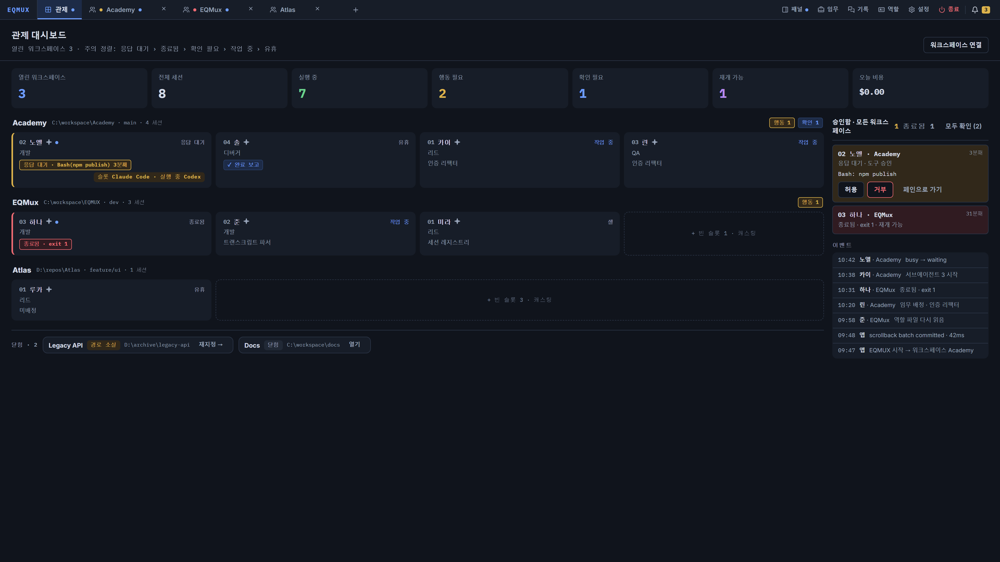
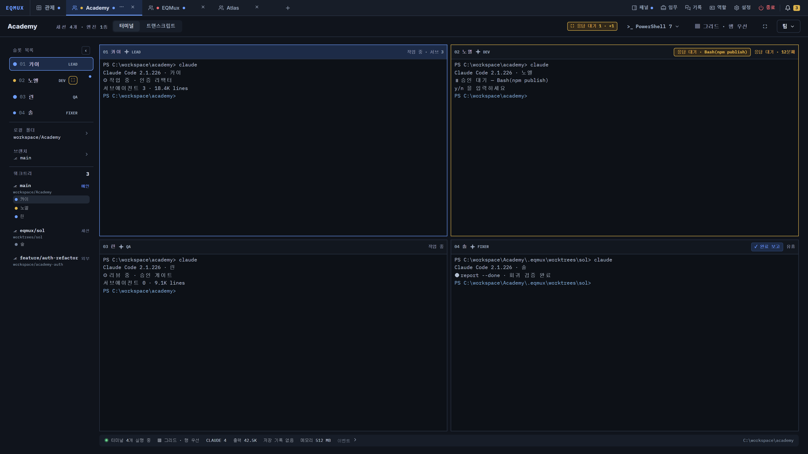
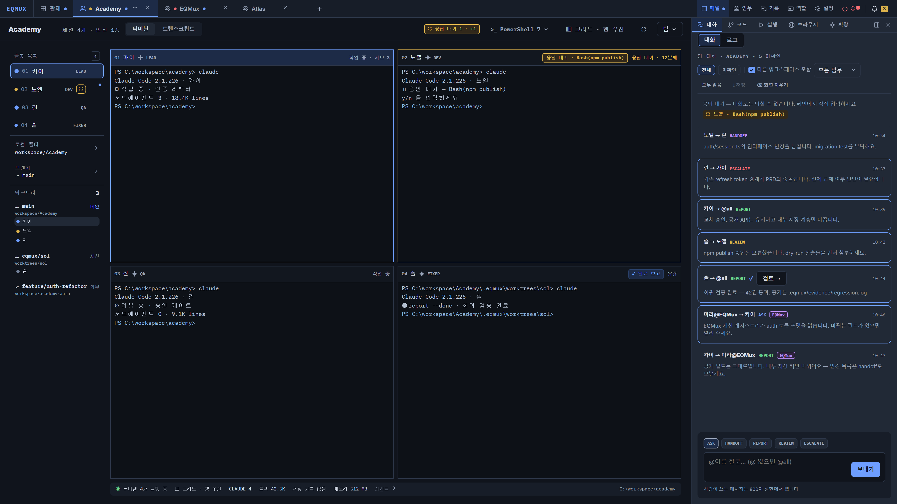
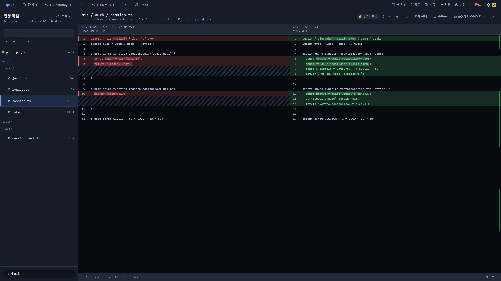
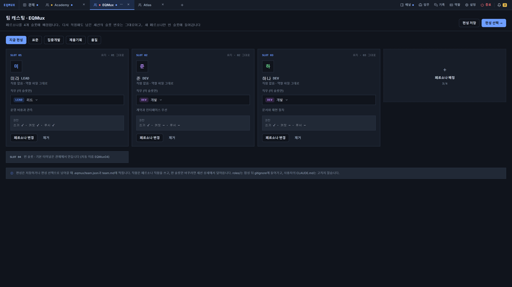

# EQMUX

*[한국어](README.md) · English*

**A desktop app where a team of AI agents works one git repo together, and a human runs the control tower.**

> **Beta.** Pre-1.0: screens and file formats may change.
>
> **Getting past install warnings** — Windows: builds are not code-signed yet, so SmartScreen shows "Windows protected your PC". Click [More info] → [Run anyway]. macOS: the app is ad-hoc signed, so Gatekeeper blocks the first launch. Right-click the app in Finder → [Open], or use [Open Anyway] in System Settings › Privacy & Security.
>
> **Where EQMUX writes, and where it doesn't** — the app data folder, `~/.eqmux/logs` (session terminal output and diagnostic logs — tokens may be kept in plain text; turn it off in Settings › Storage), and the workspace's `.eqmux/`. It never changes engine settings (`~/.claude`, `~/.codex`) or the repo's `.claude/`·`.codex/` on its own — only when you press it in the Extensions tab does it write `~/.claude/skills`, `~/.claude/settings.json`, `<repo>/.claude/skills`, or `<repo>/.claude/settings.local.json`. The app itself sends nothing over the network. Details: [CODE_SIGNING_POLICY.md](CODE_SIGNING_POLICY.md).

EQMUX is a Windows and macOS desktop app that puts agent-team supervision on top of a terminal multiplexer (MUX).
Each workspace (= 1 git repo = 1 team = 1 tab) runs four Claude Code or Codex sessions in parallel by default — six or
eight if you raise it in settings. You watch their state from the control dashboard, assign missions, and
step in when needed.



## Quick start

1. **Download** — get the file for your OS from [Releases](https://github.com/ReDocu/EQMUX/releases).
   - Windows 10/11: portable `EQMUX_<version>_x64_portable.zip` (unzip and run `EQMUX\eqmux.exe`, no admin rights needed). There is no installer before 1.0
   - macOS 11+: `EQMUX_<version>_universal.dmg`
   - For the warning on first launch, see **Getting past install warnings** above.
2. **Set up the agent CLI** — install [Claude Code](https://claude.com/claude-code) and log in once from a terminal (Codex CLI is optional). EQMUX holds no API key; it only launches this CLI. You don't need Node.js or Rust (those are only for building from source).
3. **Open a repo** — press `+` in the tab bar → `Browse folder…` and pick a git repository → choose **Quick start** → `Start with 2 sessions → Workspace`.

The full guide is in the [user documentation](docs/site/docs.md) (Korean).

## Core principles

- **Supervision is the point.** See team state (busy / waiting / dead) on the dashboard, assign missions, intervene.
- **The terminal panes are the workspace.** The actual work is done by the agent CLI (Claude Code) in each pane.
- **The app holds no API key.** It has no AI loop of its own — it only launches an external CLI.
- **Files are the source of truth.** Teams, roles, and missions live as files under `.eqmux/`; the DB is a cache. On conflict, the file wins.
- **There is no automatic execution path.** A user's button is always what changes state. Even after a restart, agents are not brought back automatically — **a human presses resume**.

## Domain model

```
App  ──────────────── up to 10 workspaces open at once
└─ Workspace ──────── = 1 git repo · 1 team · 1 tab
   ├─ Session 1–N ─── = 1 agent · 1 terminal pane
   │  └─ Role ─────── = job + persona
   └─ Mission ─────── = a unit of work in the repo (branch + goal)
```

N is four session slots by default, raisable to six or eight in settings. The default of four is about
**legibility**, not resources — at 1920×1080, a 2×2 split is the limit at which an agent TUI stays readable.
Team composition (`team.json`) allows up to eight slots regardless of this setting.
Auxiliary panes (editor, diff, browser) do not consume session slots.

## Features

- **Control dashboard** — workspace × session grid, sorted by what needs attention, waiting/dead surfaced first, approval inbox (`Allow` / `Deny`), while-you-were-away summary, event feed for state transitions and missions, OS notifications plus an in-app notification center (subagent counts show in session detail and the busy card, not in the feed)
- **Terminal workspace** — ConPTY + xterm.js, 6 pane layouts + draggable splitters + zoom, in-terminal search (Ctrl+F), link detection, clipboard and drag-and-drop
- **Agent runtime** — managed launch of Claude Code and Codex sessions (role, permission flags, hooks and resume attached), state detection via registry watch + hooks, resume and permission restart, degraded-observability indicator
- **Teams · roles · missions** — casting presets, job/persona library (global + per-workspace override), role-file frontmatter decides execution permissions
- **Session persistence** — SQLite (WAL) scrollback storage, replays the last 500 lines on restart (SGR colors preserved) with explicit resume, FTS full-text search, child process tree cleanup via Job Objects, survives webview crashes
- **Message bus** — typed inter-agent messages (ask / handoff / report / review / escalate), state-aware delivery (immediate when idle, at end of turn when busy), humans join with `@session` and `@all`, deliver by name to sessions in other open projects, save the whole ledger to a Markdown file
- **Dev tool panels** — four groups: conversation · code (git · docs) · run (server · ports) · browser. git (status · branches · staging · commits), explorer (file CRUD), extensions (skills · plugins), env files, logs, diff viewer, and a browser panel that opens any http/https address
- **Transcript view** — read Claude Code JSONL logs turn by turn (reference only), collapsible tool calls, scrollback fallback
- **External interface** — `eqmux send · report · who · browser · ping` CLI over a named pipe, statusLine cost collection. Claude Code and Codex agents talk to each other over the same bus
- **Browser control** — agents drive the browser panel with `eqmux browser open · snapshot · click · type · get-text · eval`. Not a hidden window — **the panel the human is watching** is the one that moves
- **Settings · themes** — dark/light/system themes, notification routing, session slot count (4 · 6 · 8), replay line count, all persisted to settings.json

## What's new in 0.6

- **Quick start** — pick a folder and start right away with two Claude Code sessions (lead and developer). The wizard's step bar shows where you are and where it ends
- **Approval inbox** — sessions waiting for tool approval gather on the control dashboard; read the request, then press `Allow` or `Deny`. Whichever answers first, the pane or the dashboard, wins
- **While you were away** — come back after more than a minute and one card shows what changed: state, messages, cost, done reports
- **Mission review** — when a done report arrives, see the goal, deliverables, files the assigned sessions edited, the diff since the start point, and a test run on one screen, then `Approve` or `Send back`. Prerequisite missions and per-mission cost too
- **Concurrent-edit and outside-owns warnings** — when two sessions edit the same file, or a session edits outside its title's owned paths, the pane header and notification center say so. Nothing is blocked
- **Git screen** — stage files and hunks, commit and amend, push and pull, merge and rebase, resolve conflicts. Hard-to-undo actions ask first
- **Daily cost budget** — once today's cost across all workspaces passes the budget, you're notified once a day. Sessions keep running
- **Extensions and env tabs** — view skills and plugins by global / this repo and turn them on or off. Edit `.env` files inside the app
- **Past session search and jump palette** — find and open past conversations; `Ctrl+Shift+K` jumps to a session, workspace, mission, or screen
- **First-run notice** — shows once where the app writes and doesn't, and other tools' global instructions and hooks. See it again and copy diagnostics in Settings › About

## What's new in 0.5

- **Titles and session names** — a team with two developers can tell "client developer" from "server developer". Name a session when you create it (leave it blank for an automatic name such as `EQMUX01`); pane headers show a two-digit slot number
- **Shorter messages** — senders show by name (`[EQ·ask] Kai: …`) and agent message bodies are capped at 800 characters. Longer content goes in a file, sent by path with `eqmux send --file`
- **Messages across projects** — `--to @name` finds the recipient in every open project. `eqmux who` lists the addresses
- **Completion signal** — `eqmux report --done` notifies the human and replies to the teammate who handed off the work
- **Attention loop** — the app-bar bell (notification center) and `Ctrl+Shift+U` take you straight to the pane that needs you
- **Tidier menus** — the side panel is now four groups: conversation · code · run · browser. New shortcuts open folders in Explorer and the remote repository in your browser, and a server tab runs dev servers
- **Confirmations and data kept** — stopping a session or removing a basic terminal asks first. Updates keep your workspace registrations and layout (the session history DB is moved to `session.db.bak`)
- **Don't run an older version again** — 0.4.x and earlier empty the app data folder on startup when the version differs. Launching an old executable (portable builds included) once after using 0.5 wipes your workspace registrations and layout, so delete old executables. From 0.5.1 a copy of the registrations and layout is kept in `%APPDATA%\com.eqment.eqmux.backup` and restored on startup if they are gone

## Screens

> Screenshots render the current UI with demo data.

**Workspace** — the terminal split is where work happens (the screenshot shows the default four-way). Sessions and missions on the left; the
inspector on the right shows the selected session's state, launch flags, memory, and whether it can resume,
and lets you adjust slot permissions.



**Conversation panel** — inter-agent messages carry an enforced type (ASK / HANDOFF / REPORT / REVIEW /
ESCALATE), and humans join the same stream with `@session` or `@all`. It opens straight from the app bar,
even in terminal fullscreen.



**Git diff & editor** — review agent-authored changes, split between committed state and the worktree.
Stage, commit, and push from the git screen; risky actions ask first.



**Team casting** — assign a job + persona to each slot using a preset (standard / dev-heavy /
product / quality). Each slot carries a preview of its execution permissions (write / commit / push).



## Tech stack

| Area | Technology |
|---|---|
| Shell | [Tauri 2](https://tauri.app) — the Rust backend owns PTYs, storage, and agent processes |
| Frontend | [SolidJS](https://solidjs.com) + TypeScript + Vite |
| Terminal | ConPTY ([portable-pty](https://crates.io/crates/portable-pty)) + [xterm.js](https://xtermjs.org) |
| Storage | SQLite (rusqlite, WAL) for sessions · scrollback · events / JSON for settings · layout / files for teams · roles · missions |
| Platform | Windows (WebView2 · Job Objects · portable zip) · macOS 11+ (universal dmg) |

## Building from source

If you just want to use the app, [Quick start](#quick-start) above is enough. This section is for developers.

### Requirements

- Windows 10/11 (WebView2) or macOS 11+
- [Node.js](https://nodejs.org) 18+
- [Rust](https://rustup.rs) (stable)
- [Claude Code CLI](https://claude.com/claude-code) — required to run agent sessions (Codex CLI is optional)

### Development

```powershell
npm install
npm run tauri dev     # Tauri dev mode (Vite + Rust)
```

### Build

```powershell
npm run tauri build -- --no-bundle   # src-tauri/target/release/eqmux.exe (no installer before 1.0)
```

To check only the frontend, run `npm run build` (tsc --noEmit + vite build).

## Project layout

```
├─ src/                  # SolidJS frontend
│  ├─ screens/           # screens (control center · team casting/composition · session detail · settings …)
│  ├─ components/        # app bar · terminal pane · side panels (git/ports/logs/conversation) …
│  └─ backend/           # Tauri invoke wrappers + MockBackend
├─ src-tauri/src/        # Rust backend
│  ├─ ipc.rs, job.rs     # ConPTY spawn · Job Object lifetime management
│  ├─ agent.rs           # Claude Code · Codex adapters (launch · state detection · resume · hooks)
│  ├─ store.rs           # SQLite session store (scrollback · events · FTS)
│  ├─ team.rs, roles.rs, missions.rs   # .eqmux file contract
│  └─ cli.rs             # eqmux CLI · named pipe
└─ docs/
   ├─ prd/               # feature PRDs (decision log in 00-index.md)
   ├─ implementation-status.md   # implementation status against the PRDs
   ├─ technical-guide.md         # internal technical guide (UML, sequences, maintenance recipes; Korean)
   └─ screenshots/       # screen captures
```

## Workspace file contract (`.eqmux/`)

| File | Role |
|---|---|
| `team.json` | source of truth for team composition (committed) |
| `team.md` | derived table that agents read (committed) |
| `roles/<session>.md` | composed per-session role — frontmatter `permissions` decides the execution flags (gitignored) |
| `missions/*.md` | mission definitions (branch + goal) |

Your `CLAUDE.md` is never modified — roles reach the agent only through a role-file pointer in the session start prompt (`--append-system-prompt` for Claude Code, `developer_instructions` for Codex) and a SessionStart hook.

## Using alongside other tools

Other multiplexers and agent tools (wmux, cmux, …) sometimes write their own instructions and hooks into the Claude Code global config (`~/.claude/CLAUDE.md`, `~/.claude/settings.json`) — for Codex, `~/.codex/AGENTS.md`, `config.toml`, `hooks.json`. Agents in EQMUX sessions then follow them too, e.g. calling `wmux browser` first and switching to `eqmux browser` only after it fails.

EQMUX doesn't edit engine config. Instead, the session start prompt tells the agent it runs inside EQMUX and should use `eqmux` commands, not another multiplexer's — this shares the conversation with your global `CLAUDE.md`, so it isn't guaranteed to win. At startup and in diagnostics, EQMUX also **reads** the global config, looks for other tools' traces (managed blocks, their hooks, "You are running inside …" lines), and reports them in the notification center.

To reduce conflicts:

1. If you don't use that tool, turn off its Claude Code integration in its own settings.
2. If you use both, put one line **outside** its managed block: "If the `EQMUX_SESSION` environment variable is set, you are inside EQMUX — ignore the instructions in this block." Inside the block, the tool overwrites it.
3. Block specific commands with `permissions.deny` in `~/.claude/settings.json`, e.g. `"Bash(wmux:*)"`.

Other tools' hooks still run in EQMUX sessions — the `--settings` EQMUX passes is added to your user settings and can't remove them. Diagnostics show them as "N other-tool hooks run on every tool call". Settings › About shows the findings again; after changing that tool's config, choose **Check again**.

## Feedback

File bugs and ideas in [GitHub Issues](https://github.com/ReDocu/EQMUX/issues) (paste Settings › Copy diagnostics). Security issues: see [SECURITY.md](SECURITY.md). To contribute: [CONTRIBUTING.md](CONTRIBUTING.md). It's still pre-1.0, so anything helps.

- [English feedback form](https://docs.google.com/forms/d/e/1FAIpQLSdGjEUhbjNoMhi3BiYAeTRnTOPoxqKNKsN4_m0_6Ta_6KcMNw/viewform)
- [한글 문의 폼](https://docs.google.com/forms/d/e/1FAIpQLScn7JEfOpWv1W7FPJwDIFluvRkK_y6_dpOPCe6E-opf-YHHKw/viewform)

## License

MIT — see [LICENSE](LICENSE) for details.
