# EQMUX 문서

> 버전 0.5.0 · Windows 10/11
>
> 화면 캡처는 데모 데이터로 렌더링한 것입니다.

## 목차

1. [EQMUX란](#eqmux란)
2. [설치](#설치)
3. [시작하기](#시작하기)
4. [핵심 개념](#핵심-개념)
5. [화면 안내](#화면-안내)
6. [팀 만들기](#팀-만들기)
7. [임무](#임무)
8. [에이전트 세션](#에이전트-세션)
9. [대화](#대화)
10. [코드 검토](#코드-검토)
11. [영속성과 복구](#영속성과-복구)
12. [설정](#설정)
13. [단축키](#단축키)
14. [eqmux CLI](#eqmux-cli)
15. [파일 구조](#파일-구조)
16. [레시피](#레시피)
17. [문제 해결](#문제-해결)
18. [다른 도구와 같이 쓰기](#다른-도구와-같이-쓰기)
19. [설계 경계](#설계-경계)

---

## EQMUX란

**하나의 git 저장소를 AI 에이전트 팀이 함께 작업하고, 사람이 그것을 관제하는 데스크톱 앱입니다.**

터미널 멀티플렉서(여러 터미널을 한 창에서 다루는 도구)에 에이전트 팀 관제를 얹었습니다. 저장소마다 여러 개의 에이전트 세션을 병렬로 띄우고, 관제 대시보드에서 상태를 보고, 임무를 배정하고, 필요할 때 개입합니다.

EQMUX가 하는 일과 하지 않는 일이 뚜렷합니다.

- **하는 일** — 터미널을 띄우고, 에이전트 상태를 관측하고, 역할과 임무를 파일로 관리하고, 결과를 검토할 도구를 제공합니다.
- **하지 않는 일** — 스스로 AI를 호출하지 않습니다. API 키를 갖지 않습니다. 승인 · 커밋 · push는 사람이 버튼을 눌러야 일어납니다. 자세한 내용은 [설계 경계](#설계-경계)를 보세요.

---

## 설치

### 요구 사항

| 항목 | 내용 |
|---|---|
| 운영체제 | Windows 10 / 11 (WebView2 런타임) |
| 에이전트 CLI | [Claude Code](https://claude.com/claude-code) 2.1.316 이상 또는 Codex CLI 0.146.0 이상 — 에이전트 세션 기능에 필요. 설치하고 로그인해 두세요. 한 팀에 둘을 섞을 수 있습니다. 더 낮은 버전도 실행은 되지만 일부 기능이 동작하지 않을 수 있습니다 |
| git | 저장소 연결 · 워크트리 · diff 기능에 필요 |

EQMUX 자체는 API 키를 요구하지 않습니다. 에이전트 인증은 CLI가 담당합니다.

### 설치하기

릴리스는 포터블 zip `EQMUX_<버전>_x64_portable.zip`으로 배포합니다. 압축을 풀고 `EQMUX\eqmux.exe`를 실행하면 됩니다. 설치 과정이 없어 **관리자 권한이 필요 없습니다**.

`eqmux.exe`는 앱이자 곧 CLI입니다 — 별도로 설치할 것이 없습니다. 앱이 띄우는 터미널에는 이 폴더가 `PATH` 앞에 붙으므로 어디서든 `eqmux` 명령을 쓸 수 있습니다.

### 소스에서 빌드

```powershell
npm install
npm run tauri dev      # 개발 모드
npm run tauri build -- --no-bundle    # eqmux.exe만 (배포용)
npm run tauri build                  # NSIS 설치본까지 생성
```

Node.js 18+ 와 Rust(stable)가 필요합니다.

---

## 시작하기

앱을 처음 켜면 관제 대시보드가 열립니다. 아직 저장소가 없으니 연결부터 합니다. 온보딩은 네 단계입니다 — **저장소 연결 → 실행 방식 → 세션 구성 → 시작**.

### 1단계 · 저장소 연결

탭 줄의 `+`를 눌러 연결 화면을 엽니다. 워크스페이스 탭을 우클릭하거나 `⋯`를 눌러 `워크스페이스 관리…`로도 열 수 있습니다.

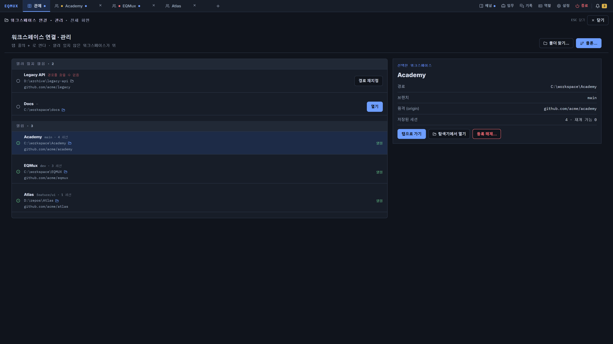

- **로컬 저장소 연결** — 이미 있는 git 저장소 폴더를 고릅니다
- **원격에서 Clone** — 원격 주소로 새로 받아옵니다

등록은 무제한이고, 동시에 열 수 있는 워크스페이스는 10개입니다. 저장소를 옮겼다면 `재지정`으로 경로만 다시 잡아주면 됩니다. `등록 해제`는 목록에서만 지우고 **디스크의 파일은 건드리지 않습니다.** 등록과 배치는 앱을 새 버전으로 바꿔도 남습니다.

### 2단계 · 실행 방식 고르기

저장소를 열면 첫 세션을 어떻게 시작할지 묻습니다.

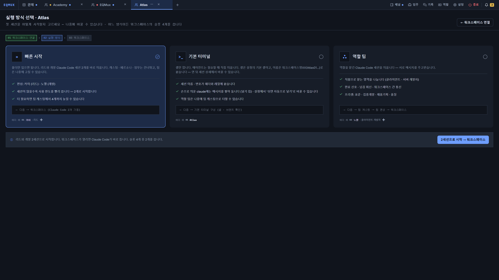

| 선택 | 언제 |
|---|---|
| **기본 터미널** (권장) | 일반 셸 작업, 빠른 확인, 수동 명령 실행. 역할·페르소나·임무 없이 바로 시작합니다 |
| **역할 팀 구성** (고급) | 병렬 구현·리뷰·조사처럼 책임이 분리된 작업. 슬롯마다 역할과 권한, 임무를 배정합니다 |

기본 터미널로 시작해도 나중에 언제든 역할을 부여할 수 있습니다.

### 3단계 · 팀 캐스팅 (역할 팀을 골랐다면)

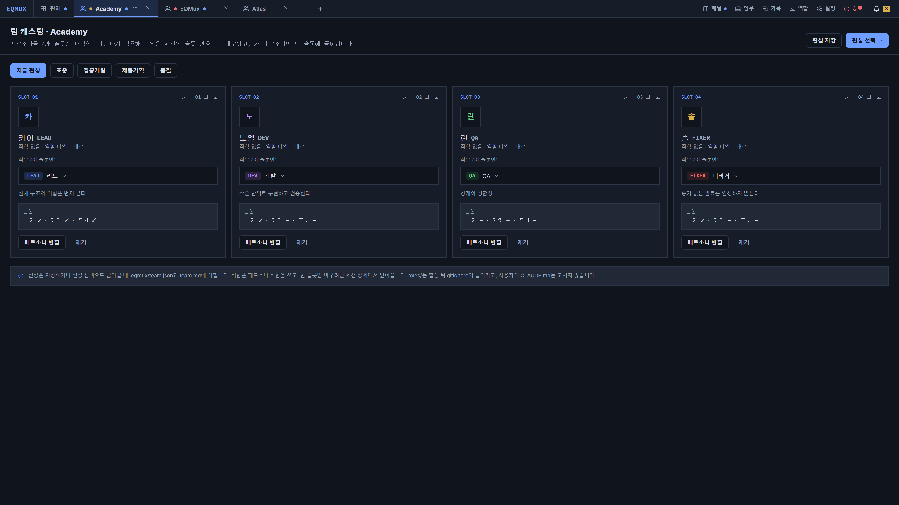

편성 프리셋을 고르면 슬롯이 자동으로 채워집니다. 슬롯마다 **직무 + 페르소나**가 배정되고, 아래에 실행 권한(`write` / `commit` / `push`)이 미리 보입니다.

`편성 선택 →`을 누르면 `.eqmux/team.json`과 `team.md`가 저장되고 세션이 만들어집니다.

### 4단계 · 에이전트 띄우기

역할 세션 페인에는 `▶ Claude Code 기동`(Codex 슬롯이면 `▶ Codex 기동`) 버튼이 있습니다. 누르면 그 페인에서 역할·권한·훅이 붙은 에이전트가 뜨고, 상태(`busy` · `waiting` · `idle`)가 실시간으로 갱신됩니다. 빈 슬롯에서 역할 세션을 새로 만들면 만들면서 바로 기동합니다.

**터미널에 직접 `claude`를 치면 역할·훅·메시지 신원이 붙지 않습니다.** 대시보드는 그 프로세스를 감지해 배지를 붙이지만, 팀 메시지는 자동으로 넣지 않습니다. 쌓아 두었다가 페인 헤더의 `메시지 N건 · 넣기`를 사람이 눌렀을 때만 넣습니다.

> **왜 앱이 알아서 띄우지 않나요?** 상태를 바꾸는 것은 언제나 사용자의 버튼이라는 원칙 때문입니다. 재시작 후에도 에이전트를 되살리지 않고, 재개는 사람이 누릅니다.

### 5단계 · 임무 배정

앱 바의 **임무** 버튼에서 임무를 만들고 세션에 배정합니다. 배정하면 그 세션의 역할 파일에 임무가 기록되고, 살아 있는 에이전트에게는 한 줄 브리프가 전달됩니다.

---

## 핵심 개념

```
앱  ─────────────────── 워크스페이스 최대 10개 동시 오픈
└─ 워크스페이스 ──────── = git repo 1개 = 팀 1개 = 탭 1개
   ├─ 세션 1~N ───────── = 에이전트 1명 = 터미널 페인 1개
   │  └─ 역할 ────────── = 직무(job) + 페르소나(persona)
   └─ 임무 ───────────── = repo 안의 작업 단위 (브랜치 + 목표)
```

| 용어 | 뜻 |
|---|---|
| **워크스페이스** | git 저장소 하나 = 팀 하나 = 탭 하나. 이 1:1:1 덕분에 git·탐색기·diff·검색의 범위가 하나로 통일됩니다 |
| **세션** | 터미널 페인 하나 = 에이전트 한 명. 기본 4개, 설정에서 6·8개까지 |
| **보조 페인** | 에디터 · diff · 브라우저 · 트랜스크립트. 세션 슬롯을 쓰지 않습니다 |
| **패널** | 사이드 도구 서랍(대화·코드·실행·브라우저). 페인이 아니라 분할 그리드 밖에 있습니다 |
| **직무** | 책임과 권한. 고정 8종 |
| **페르소나** | 판단 성향. 직무와 분리되어 있습니다 |
| **임무** | 브랜치 + 목표 + 산출물. `.eqmux/missions/*.md` 파일이 원본 |

**세션이 기본 4개인 이유**는 리소스가 아니라 가독성입니다. 1920×1080에서 2×2 분할이 에이전트 TUI를 읽을 수 있는 한계입니다(8분할이면 페인당 14행). 설정에서 늘릴 수 있고, 줄여도 이미 열린 세션은 닫히지 않습니다.

**파일이 원본입니다.** 팀·역할·임무는 `.eqmux/` 아래 파일이 원본이고 데이터베이스는 캐시일 뿐입니다. 에이전트나 외부 편집기가 파일을 바꾸면 앱이 감지해 따라갑니다.

---

## 화면 안내

### 탭바

맨 왼쪽이 **관제 고정 탭**, 그 뒤로 워크스페이스 탭이 붙습니다. `Ctrl+Shift+D`로 관제와 직전 워크스페이스를 오갑니다.

### 앱 바 전역 도구

오른쪽 위 버튼들은 어디서든(터미널 전체 화면에서도) 열립니다.

| 버튼 | 여는 것 |
|---|---|
| 대화 | 사이드 패널 (대화 탭) |
| 임무 | 임무 보기 (전체 화면). 파일은 사이드 패널 **파일** 탭에서 봅니다 |
| 기록 | 과거 세션 검색 (전체 화면) — 다시 누르면 들어오기 전 화면으로 |
| 역할 | 역할 라이브러리 (전체 화면) |
| 설정 | 설정 (전체 화면) |
| 벨 | 알림 센터 — 최근 알림 50건. 누르면 그 페인으로 갑니다 |

전체 화면 팝업은 한 번에 하나만 열리고 `ESC`로 닫힙니다. 저장소 연결 화면은 탭 줄의 `+`가 엽니다.

#### 건너뛰기 팔레트

`Ctrl+Shift+K`(macOS `⌘⇧K`)를 누르면 어디서든 건너뛰기 팔레트가 뜹니다. 터미널에 커서가 있어도 됩니다. 이름 일부를 치면 세션 · 워크스페이스 · 임무 · 화면(관제 · git · 과거 세션 검색 · 설정 · 역할 라이브러리 · 단축키) · 사이드 패널 탭 가운데 맞는 것이 나오고, 이름 앞부분이 맞는 것이 위에 옵니다. `↑` `↓`로 고르고 `Enter`로 갑니다. `ESC`나 같은 키를 한 번 더 누르면 닫히고, 커서는 팔레트를 열기 전 자리(터미널이었다면 그 터미널)로 돌아갑니다. 설정 · 역할 라이브러리 같은 전체 화면 팝업 위에서도 열리지만, 확인창 · 종료 창 · 배치 창이 떠 있을 때는 "열린 창을 먼저 닫으세요"라고 알리고 열리지 않습니다.

### 워크스페이스 탭 메뉴

워크스페이스 탭을 우클릭하거나 `⋯`를 누르면 열립니다.

| 묶음 | 항목 |
|---|---|
| 열기 | `탐색기에서 열기` · `원격 저장소 열기` · `워크스페이스 관리…` |
| 알림 | `알림 음소거` · `다른 워크스페이스 메시지 받기` |
| 닫기 | `닫기 (세션은 유지)` |

`원격 저장소 열기`는 `origin` 주소를 웹 주소로 바꿔 기본 브라우저로 엽니다. 주소에 든 사용자 정보(토큰)는 떼고 엽니다.

### 워크스페이스 화면

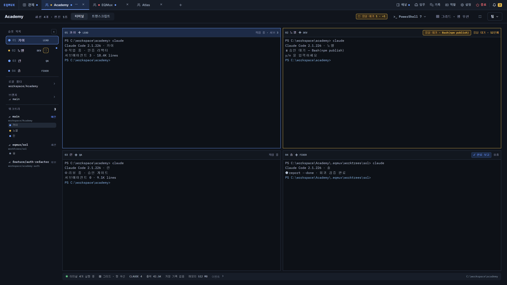

- **왼쪽 레일** — 세션 목록(두 자리 슬롯 번호 + 이름, 클릭=포커스, ⓘ=상세, 우클릭=메뉴) · 임무 수 · 워크트리 섹션
- **가운데** — 터미널 그리드 또는 트랜스크립트
- **아래 상태 바** — PTY 수 · 배치 · 출력량 · DB 크기 · 메모리 · 이벤트

### 사이드 패널

탭은 다섯 그룹이고, 그룹 안은 세그먼트로 나뉩니다. 그룹 탭을 다시 누르면 그 그룹에서 마지막으로 본 화면이 열립니다.

| 탭 | 세그먼트 | 내용 |
|---|---|---|
| **대화** | 대화 · 로그 | 에이전트 간 대화 스트림 / 이벤트 원장 스트림 + 전문 검색 |
| **코드** | git · 파일 · 문서 | 브랜치 · 커밋 · diff 진입 · git 화면 열기 / 파일 트리와 편집 / Markdown 문서 보기 |
| **실행** | 서버 · 포트 · 환경변수 | dev 서버를 띄우는 셸 / 세션이 연 포트와 시스템 포트 / `.env` 파일 보기 · 편집 |
| **브라우저** | — | 임의의 http·https 주소를 여는 웹뷰. 에이전트도 `eqmux browser`로 같은 패널을 씁니다 |
| **확장** | MCP · 플러그인 · 스킬 | 에이전트 엔진에 설치된 확장 목록 |

0.5에서 쓰던 탭 배치가 남아 있으면, 처음 켰을 때 패널 위에 묶인 모양을 한 번 알려 줍니다.

패널은 좌/우 어느 쪽에도 붙일 수 있고, 위치는 저장됩니다.

#### 환경변수 탭

워크스페이스 루트의 `.env` 계열 파일(`.env` · `.env.local` · `.env.development` 등)을 파일마다 카드로 보여 줍니다. 값은 처음에 가려져 있고, [값 보기]로 펼칩니다. 다른 워크스페이스로 옮기면 다시 가려집니다. 값을 누르면 복사되며, 복사한 값은 OS 클립보드 기록에 남지 않게 표시합니다.

- **고치기** — [+ 변수]로 더하고, 줄마다 [편집] · [삭제]가 있습니다. 바꾼 그 한 줄만 다시 쓰므로 주석 · 빈 줄 · `export` · 따옴표 · 줄바꿈 형식이 그대로 남습니다. 키는 영문자나 `_`로 시작해야 하고, 같은 키를 두 번 넣을 수 없습니다. 이미 파일 안에 겹친 키는 "중복" 칩으로 알려 줍니다.
- **여러 줄 값** — 따옴표 안에서 줄을 넘기는 값은 한 변수로 보이지만 한 줄 편집은 꺼져 있습니다. 카드의 [원문 편집]으로 파일 전체를 고칩니다.
- **외부 변경** — 편집하는 동안 에이전트나 터미널이 같은 파일을 바꿨으면 저장하지 않고 다시 읽습니다. 확인하고 다시 고치세요.
- **파일 만들기 · 지우기** — `.env`가 없으면 [.env 만들기]가, `.env.example`이나 `.env.sample`이 있으면 [그 파일에서 만들기]가 보입니다. 예시 파일은 읽기 전용 카드로 보입니다. [새 파일 ▾]로 다른 이름의 파일을 만들 수 있고, [파일 삭제]는 휴지통으로 옮깁니다.
- **git 경고** — 파일이 커밋되어 있으면 "git에 추적됨", `.gitignore`에 없으면 "git 무시 안 됨" 칩이 붙습니다. 뒤쪽 칩의 [.gitignore에 추가]를 누르면 그 줄을 더해 줍니다.

이 탭의 값은 페인이나 서버 셸의 환경에 넣지 않습니다. dev 서버가 dotenv 등으로 직접 읽는 값입니다. 값을 바꿨으면 이미 떠 있는 서버와 세션은 다시 시작해야 새 값을 읽습니다.

#### 서버 탭 저장 명령

자주 치는 명령을 저장소의 `.eqmux/commands.json`에 적어 두면, 서버 탭에 버튼으로 나옵니다. 누르면 서버 셸에 그 명령을 입력하고 Enter를 칩니다. 셸이 닫혀 있거나 서버가 이미 돌고 있으면 버튼이 꺼집니다.

```json
{
  "version": 1,
  "commands": [
    { "name": "dev", "run": "npm run dev", "kind": "server" },
    { "name": "test", "run": "npm test", "kind": "test" },
    { "name": "lint", "run": "npm run lint" }
  ]
}
```

`name`은 40자까지, `run`은 한 줄이어야 합니다. 이 조건에 맞지 않는 항목은 건너뛰고 몇 개를 건너뛰었는지 알려 줍니다. `kind`는 `server` · `test` · `other` 중 하나이고, 빼면 `other`입니다. 파일을 고친 뒤에는 서버 탭의 다시 읽기 버튼을 누르세요.

#### 세션별 포트 범위

여러 세션이 한꺼번에 dev 서버를 띄우면 포트가 부딪히기 쉽습니다. 그래서 앱은 에이전트 세션과 셸 페인마다 포트 10개짜리 범위를 하나씩 나눠 주고, 환경변수 `EQMUX_PORT_BASE` · `EQMUX_PORT_END`로 알려 줍니다(42000번부터). 역할 파일에도 이 범위로 dev 서버를 띄우라는 안내가 들어갑니다. 범위는 서버 탭의 "세션 포트 범위" 줄에 보이고, 세션이 끝나면 반납됩니다.

알려 주기만 하고 막지는 않습니다. `PORT`는 건드리지 않으므로, 서버가 이 범위를 쓰게 하려면 명령에 직접 넘기세요. 예를 들면 `npm run dev -- --port $EQMUX_PORT_BASE`처럼 씁니다(Windows PowerShell에서는 `$env:EQMUX_PORT_BASE`).

---

## 팀 만들기

### 직무 (고정 8종)

직무는 **책임**입니다. 로스터는 8종으로 고정되어 있고 추가·삭제 없이 편집만 가능합니다.

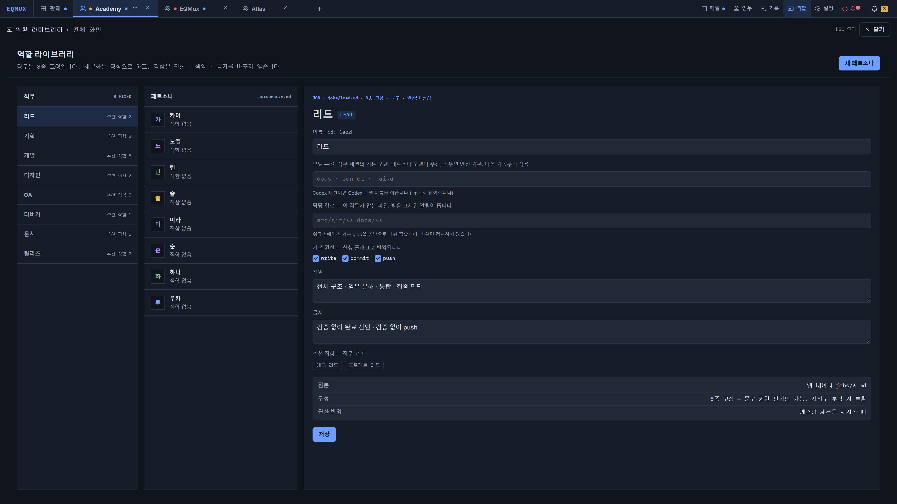

| 직무 | 책임 | write | commit | push |
|---|---|:---:|:---:|:---:|
| 리드 | 전체 구조 · 임무 분해 · 통합 · 최종 판단 | ✓ | ✓ | ✓ |
| 기획 | 요구 정리 · 조사 · 기획 문서 | ✓ | — | — |
| 개발 | 구현과 자체 검증 | ✓ | — | — |
| 디자인 | UI 설계 · 스타일 가이드 · 목업 | ✓ | — | — |
| QA | 테스트 · 증거 수집 · 변경 검토 | — | — | — |
| 디버거 | 재현 · 원인 규명 · 최소 수정 | ✓ | — | — |
| 문서 | 문서화 · 재현 절차 · 가이드 | ✓ | — | — |
| 릴리즈 | 커밋 정리 · 태그 · 배포 | — | ✓ | ✓ |

각 직무에는 **금지 사항**도 함께 정의되어 있습니다(예: QA는 "증거 없는 통과 판정 금지").

### 페르소나 (3단계)

페르소나는 **판단 성향**입니다. 프롬프트 예산은 5~10줄이고 초과하면 경고합니다.

| 레벨 | 담기는 것 |
|---|---|
| **기본** | 판단 힌트 한 줄 |
| **중간** | 판단 힌트 + 말투 + 성격 (각 3줄 예산, 말투 프리셋 제공) |
| **고급** | 캐릭터 시트 파일(`personas/<id>.character.md`). 역할 파일에는 정체성 한 줄과 경로만 들어갑니다 |

레벨을 바꿔도 값이 섞이지 않고, 낮은 레벨로 내려도 디스크의 내용은 보존됩니다.

### 캐스팅과 권한

편성 프리셋 4종으로 시작할 수 있습니다.

| 프리셋 | 구성 |
|---|---|
| 표준 | 리드 · 개발 2 · QA |
| 집중개발 | 개발 중심 |
| 제품기획 | 리드 · 기획 · 디자인 · 개발 |
| 품질 | 개발 · 디버거 · QA · 문서 |

**권한 바꾸기** — 세션 상세 패널에서 직무 기본 권한을 세션 단위로 덮어쓸 수 있습니다. 다만 실행 권한은 프로세스 수명 동안 고정이라, 권한을 바꾸면 **재시작 배지**가 뜨고 재개 기반 재시작으로 반영됩니다(대화는 유지됩니다).

**관계 보기** — 팀 편성 화면에서 보고선을 그림으로 확인합니다. 편성은 바꾸는 즉시 자동 저장됩니다.

**직함** — 같은 직무를 둘 둔 팀은 직함으로 나눕니다(예: 개발 직무의 `클라이언트 개발자`·`서버 개발자`). 페르소나에 직함을 두고, 세션 상세에서 이 워크스페이스에서만 덮어쓸 수 있습니다. 직함은 역할 파일과 `team.md`에 실려 팀원끼리 서로를 압니다.

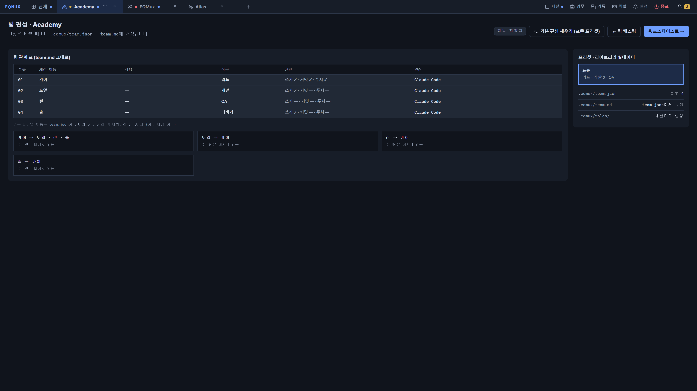

---

## 임무

임무는 `.eqmux/missions/<슬러그>.md` 파일이 원본입니다.

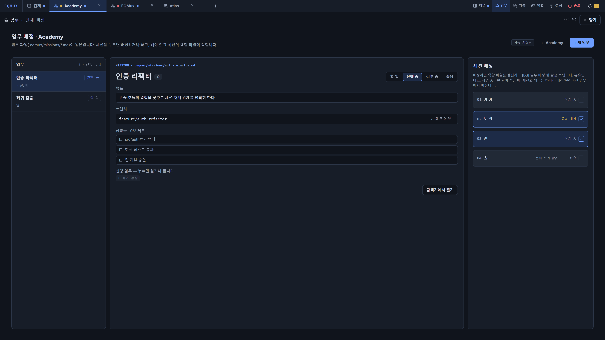

### 임무 만들기

임무 화면 오른쪽에서 이름 · 목표 · 브랜치(선택)를 넣고 생성합니다. 목표는 **완료 조건을 측정 가능하게** 쓰는 것이 좋습니다.

### 배정

임무 카드의 세션 칩을 클릭하면 배정/해제가 토글됩니다. 배정하면

1. 그 세션의 역할 파일에 임무 블록이 삽입되고
2. 살아 있는 에이전트에게 자연어 브리프 한 줄이 전달됩니다

### 상태와 브랜치

- 상태 뱃지를 클릭하면 `todo → in-progress → in-review → done` 순으로 돕니다. 본문은 그대로 보존되고 frontmatter만 갱신됩니다.
- `⎇ 체크아웃`으로 임무 브랜치로 전환합니다. 공유 저장소 전체에 영향을 주므로 2단 확인을 거칩니다.
- ★ 뱃지로 **기본 임무**를 지정하면(워크스페이스당 1개), 임무 없는 새 역할 세션이 만들어질 때 자동으로 배정받습니다.

### 파일 탭

워크스페이스의 파일은 사이드 패널 **코드 › 파일** 탭에서 봅니다. 관제 화면 레일의 [로컬 폴더]를 눌러도 이 탭이 열립니다. 위는 파일 트리, 아래는 미리보기이고, 임무 파일은 구조화되어 보입니다. 임무 목록은 앱 바 **임무** 버튼의 전체 화면에서 봅니다.

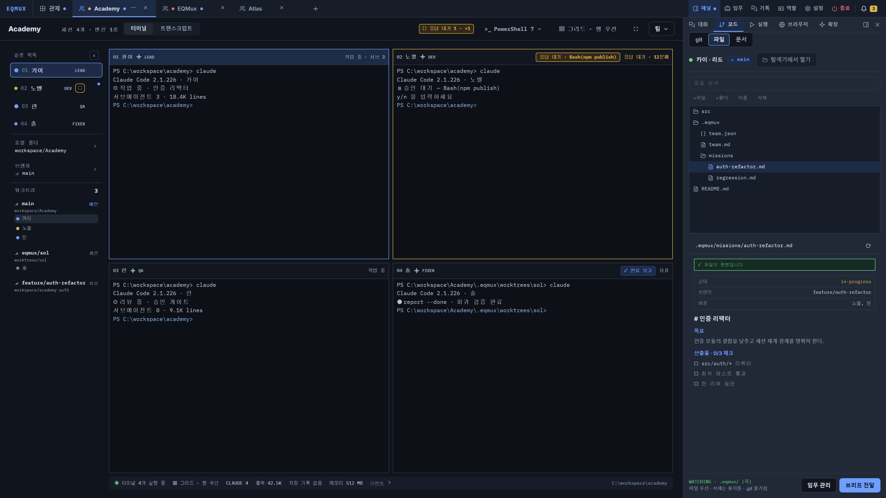

파일 생성 · 이름 변경 · 삭제(휴지통) · 편집 저장이 모두 가능합니다. `.git` 폴더는 이 탭에서 고칠 수 없으니 git 명령으로 다루세요. 삭제는 영구 삭제가 아니라 휴지통으로 갑니다.

다른 탭으로 옮겨도 편집 중인 내용은 남습니다. 저장하지 않은 편집이 있는데 패널을 닫으면 한 번 묻습니다.

---

## 에이전트 세션

### 셸 우선 모델

모든 세션은 일반 셸로 시작합니다. 에이전트 실행은 언제나 사용자의 명시적 행동입니다.

- 역할 세션은 페인의 `▶ Claude Code 기동` · `▶ Codex 기동` 버튼이나 우클릭 메뉴로 띄웁니다
- 터미널에서 직접 `claude`를 실행하면 대시보드가 감지해 배지만 붙입니다. 역할·훅은 붙지 않습니다

### 세션 이름과 번호

세션을 만들 때 이름을 정합니다. 비워 두면 기본 터미널은 `프로젝트명XX`(예: `EQMUX01`), 역할 세션은 페르소나 이름이 붙습니다. 이름은 24자 이내이고 공백·`@`는 쓸 수 없으며, 같은 워크스페이스에서 겹치면 다른 이름을 제안합니다. 페인 헤더와 레일의 이름 앞에는 두 자리 슬롯 번호(`01`~`08`)가 붙습니다. 번호는 이름을 바꾸거나 앱을 다시 켜도 그대로입니다.

### 상태 6종

| 상태 | 뜻 |
|---|---|
| `starting` | 기동 중 |
| `busy` | 작업 중 (실행 중인 도구와 서브에이전트 수를 함께 표시) |
| `waiting` | 사람의 승인·입력 대기 — **알림 대상** |
| `shell` | 에이전트 없이 셸만 |
| `idle` | 에이전트가 유휴 (턴 종료) |
| `dead` | 프로세스 종료 — **알림 대상** |

색은 `waiting`과 `dead`에만 씁니다. 나머지는 무채색 안에서 구분합니다.

**판정 근거** — 상태 라벨에 마우스를 올리면 그 상태로 바뀐 까닭이 보입니다. 예를 들어 어떤 훅이 언제 와서 바뀌었는지, 직접 띄운 claude를 붙였는지, 프로세스가 끝났는지입니다. 세션 상세 패널의 `판정 근거` 행에도 같은 내용이 있습니다. 상태가 이상해 보일 때 먼저 여기를 보세요.

**멈춤** — `busy`인데 10분 넘게 훅이 하나도 오지 않으면 `멈춤 · 한동안 출력 없음` 칩이 붙습니다. 오래 걸리는 명령을 기다리는 중일 수도 있고, 에이전트가 멈췄을 수도 있습니다. 페인을 직접 확인하세요. 훅이 다시 오면 칩은 저절로 사라집니다. 상태는 `busy` 그대로이고 알림도 내지 않습니다.

### 세션 상세 패널

레일의 ⓘ 버튼(또는 세션 더블클릭)으로 엽니다.

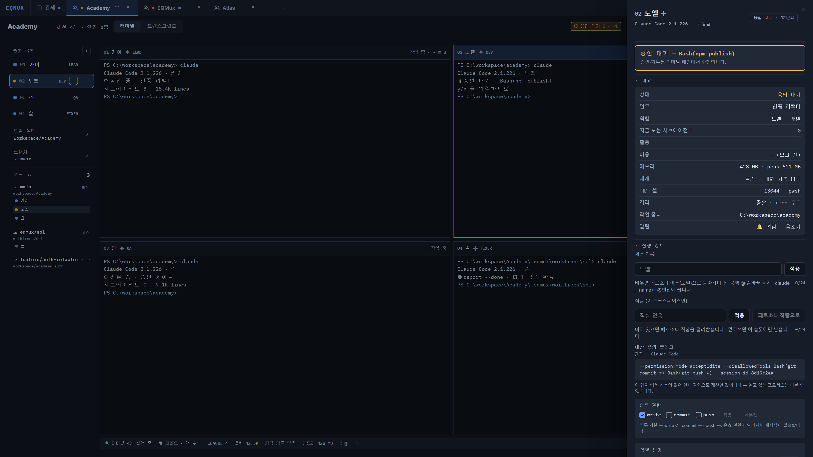

상태 · 임무 · 역할 · 서브에이전트 · 활동 · 비용 · 메모리 · 재개 가능 여부 · PID · cwd · 격리 방식과 함께, **실제 실행 플래그 원문**을 그대로 보여줍니다. 여기서 세션 이름 변경, 슬롯 권한 조정, 역할 변경, 점프·재개·중지를 할 수 있습니다.

에이전트가 서브에이전트를 띄운 적이 있으면 상세 아래쪽에 **서브에이전트** 목록이 생깁니다. 띄운 시각 · 종류 · 맡긴 일의 설명이 한 줄씩 보입니다. 읽기 전용이고, 상세를 다시 열면 새로 띄운 것까지 갱신됩니다.

### 승인함

도구 사용 승인을 기다리는 세션은 관제 대시보드의 `기다리는 에이전트` 목록에 오래 기다린 순으로 올라옵니다. 닫아 둔 워크스페이스의 세션도 포함됩니다. 각 줄에 기다리는 도구와 원문(예: `Bash: mkdir build`)이 보이므로, 무엇을 허락하는지 읽고 누르세요.

| 버튼 | 동작 |
|---|---|
| `허용` | 에이전트가 그 도구를 실행합니다. 페인의 승인 창은 저절로 닫힙니다 |
| `거부` | 실행하지 않고, 에이전트에게 거부되었다고 전합니다 |
| `페인으로 가기` | 그 페인으로 가서 직접 답합니다 |

- **페인의 승인 창도 그대로 떠 있습니다.** 페인과 대시보드 중 먼저 답한 쪽이 이깁니다. 페인에서 먼저 답했다면 대시보드 버튼은 아무것도 넣지 않고 "이미 페인에서 답했습니다"라고 알립니다. 한 요청이 두 번 실행되는 일은 없습니다.
- 누르는 사이 에이전트가 다른 것을 기다리게 되었으면 버튼은 동작하지 않고 그 페인으로 데려갑니다. 화면에 보인 것과 다른 요청을 허락하지 않기 위해서입니다.
- `허용` · `거부`는 도구 승인에만 있습니다. 질문에 답하기 · 계획 승인은 고를 것이 여러 개라 페인에서 답합니다.
- 승인 요청이 9분 30초 넘게 남아 있으면 앱은 기다리기를 그만둡니다. 그 뒤에는 페인에서 답하세요.
- Codex 세션은 앱에서 답할 수 없습니다. 페인에서 답하세요.

### 같은 파일 동시 편집

같은 워크스페이스의 두 세션이 10분 안에 같은 파일을 고치면 경고가 뜹니다. 관제 대시보드에는 `○○ · △△이(가) 동시에 편집 중` 카드가, 그 세션들의 페인 머리에는 `동시 편집 · 파일 이름` 칩이 붙습니다.

- 앱은 막지도, 에이전트에게 저절로 알리지도 않습니다. `○○에게 알리기`를 누르면 그 세션에게 보낼 메시지 초안이 열리고, 사람이 고쳐서 보냅니다.
- `닫기`로 카드를 치워도 같은 파일에 새 편집이 오면 다시 뜹니다.
- Claude Code의 편집 도구로 고친 것만 잡습니다. 셸 명령으로 고친 파일과 Codex 세션의 편집은 잡지 않습니다.
- 세션이 고친 파일 목록은 임무 검토 화면의 `담당 세션이 고친 파일`에도 쓰입니다.

### 사용 한도와 컨텍스트

Claude Code 세션은 응답마다 사용 한도와 컨텍스트 사용률을 알려 줍니다. 앱은 이것을 세 군데에 보입니다.

| 자리 | 표시 |
|---|---|
| 관제 대시보드 `오늘 비용` 칸 | 열린 세션 중 가장 많이 쓴 한도를 함께 보입니다(예: `$3.20 · 5시간 한도 62%`). 80%를 넘으면 노란색. 마우스를 올리면 재설정 시각 |
| 페인 머리 `ctx N%` | 그 세션의 컨텍스트 사용률. 첫 응답 뒤부터 보이고, 85%를 넘으면 노란색입니다. 높으면 `/compact`를 쓰거나 다른 세션으로 일을 넘기세요 |
| 페인 머리 `한도 소진` 칩 | 한도를 다 썼을 때. 그 세션에 온 메시지는 쌓아 두었다가 한도가 풀리면 넣습니다 |

한도와 컨텍스트는 Claude Code가 알려 주는 값을 그대로 옮긴 것입니다. Codex 세션에는 보이지 않습니다.

### 임무별 비용

Claude Code 세션의 비용은 그때 그 세션이 맡고 있던 임무에 쌓입니다. 임무 화면의 임무 카드와 임무 검토 화면에 `비용 $N`으로 보입니다.

- 한 세션이 임무를 여러 개 맡고 있으면 가장 최근에 배정된, 아직 끝나지 않은 임무에 쌓습니다.
- 임무를 맡지 않은 동안 쓴 비용은 어느 임무에도 넣지 않습니다. 관제의 `오늘 비용` 합계에는 들어갑니다.
- 앱을 다시 켜도 이어서 셉니다. 기록은 30일 동안 둡니다.
- Codex 세션은 비용을 알려 주지 않아 세지 않습니다.

### 재개와 재시작

- **재개** — 같은 세션 ID와 cwd로 `--resume`. 대화가 이어집니다. 재개 가능 여부는 트랜스크립트 존재로 실측합니다.
- **권한 재시작** — 권한이 바뀌면 재시작 배지가 뜹니다. 재개 기반으로 다시 띄우므로 대화는 유지됩니다.
- **자동 재시작 없음** — 프로세스가 죽으면 `dead`로 표시만 하고 되살리지 않습니다. 자동 재시작은 크래시 루프를 만들기 때문입니다.

### 과거 세션 검색

앱 바 **기록**(또는 건너뛰기 팔레트의 "과거 세션 검색")을 누르면, 이 워크스페이스 폴더에서 돌았던 Claude Code 대화를 낱말로 찾을 수 있습니다. 대소문자는 가리지 않고, 사람이 쓴 말과 에이전트의 답만 찾습니다(도구 출력은 찾지 않습니다). 결과는 대화별로 묶여 최근 대화부터 나오고, 줄마다 시각 · 사람/에이전트 · 앞뒤 문맥이 보입니다.

| 대화 | 버튼 |
|---|---|
| 꺼진 세션의 마지막 대화 | **재개** — 세션 상세의 재개와 같습니다. 그 세션이 그 대화로 다시 뜨고 그 페인으로 갑니다 |
| 켜져 있는 세션의 대화 | **세션으로 가기** |
| 세션의 예전 대화 · 앱 밖 터미널에서 돈 대화 | **재개 명령 복사** — `claude --resume <id>`를 복사합니다. 이 폴더의 터미널에 붙여 넣어 이어 갑니다 |

결과는 한 번에 200줄, 대화마다 20줄까지 보입니다. Codex 대화와 워크트리에서 돈 세션의 대화는 아직 찾지 않습니다.

### 알림

| 항목 | 동작 |
|---|---|
| 대상 | `waiting` · `dead` 진입, 에이전트의 완료 보고(`eqmux report --done`). 30초 넘게 일한 턴의 완료는 기본으로 칩만 띄우고, 설정에서 OS 알림을 켤 수 있습니다 |
| 긴급 에스컬레이션 | 에이전트가 `eqmux send --type escalate --severity high`로 보낸 메시지. 합침(60초)을 건너뛰고 한 건마다 알림 센터와 OS 알림에 하나씩 뜹니다. 포커스 · 음소거 · 알림 끔 설정은 그대로 따릅니다. 대화 탭에는 빨간 `긴급` 칩이 붙고, 읽기 전까지 그 세션이 관제와 알림 센터에서 응답 대기보다 위에 옵니다 |
| 알림 센터 | 앱 바 벨. 창에 포커스가 있어 OS 알림을 내지 않은 것도 쌓입니다. 누르면 그 페인으로 갑니다 |
| 다음 미확인으로 | `Ctrl+Shift+U` 또는 `⛶ 응답 대기` 칩. 열린 모든 워크스페이스를 오래 기다린 순으로 돕니다 |
| 억제 | 앱 창에 포커스가 있으면 알리지 않음 |
| 합침 | 세션당 최소 60초 간격, 그 사이 발생분은 "(N건 합침)" |
| 음소거 | 세션·워크스페이스 단위. 알림만 막고 인앱 미확인 표시는 유지 |
| 의도한 종료 | 사용자가 중지한 세션의 `dead`는 알리지 않음 |

미확인 표시는 세션 셀 → 워크스페이스 탭 → 관제 탭으로 전파되고, 해당 페인을 보거나 상세를 열면 해제됩니다.

**엔진 버전 알림** — 세션을 시작할 때 Claude Code · Codex 버전을 확인합니다. 앱이 확인한 최소 버전(Claude Code 2.1.316 · Codex 0.146.0)보다 낮으면 알림 센터에 한 번 알립니다. 세션은 그대로 돌지만 승인함 · 사용량 표시 같은 기능이 동작하지 않을 수 있습니다. 같은 버전으로는 다시 알리지 않습니다. OS 알림은 내지 않습니다.

### 관측 저하(degraded)

에이전트 상태를 읽는 경로에 접근할 수 없게 되면 살아 있는 세션에 **"낮은 신뢰"** 뱃지가 붙습니다. 그동안에도 앱은 계속 동작하고, 접근이 회복되면 자동으로 해제됩니다. 이 전환은 이벤트 피드에 기록됩니다 — 조용히 열화되지 않습니다.

### 엔진별 지원

Claude Code와 Codex는 같은 역할 파일 · 같은 메시지 버스(`eqmux send`) · 같은 권한 원천(역할 파일 frontmatter)을 씁니다. 다른 것은 각 CLI에 그것을 싣는 방법입니다. Codex는 Codex CLI 0.146.0에서 확인했습니다.

| 항목 | Claude Code | Codex |
|---|---|---|
| 역할 주입 | `--append-system-prompt`로 세션 시작 안내문을 붙이고, SessionStart 훅이 역할 파일을 컨텍스트로 싣습니다 | `-c developer_instructions='…'`로 같은 안내문을 붙이고, 같은 SessionStart 훅이 역할 파일을 싣습니다 |
| 훅 주입 | 앱 데이터의 `hook-settings.json`을 `--settings`로 얹습니다 | `-c hooks.<이벤트>=[…]` 인라인 설정으로 얹습니다. 앱이 쓴 `eqmux _hook`만 거는 훅이라 `--dangerously-bypass-hook-trust`로 훅 심사를 건너뜁니다 |
| 사용자 설정 | `~/.claude` · repo `.claude/`는 건드리지 않습니다 | `~/.codex` · repo `.codex/`는 건드리지 않습니다 |
| 승인 대기 감지 | Notification 훅 · PermissionRequest 훅 | PermissionRequest 훅 |
| 앱에서 승인 · 거부 | 됩니다(승인함) | 안 됩니다. 페인에서 답합니다 |
| 역할의 모델 지정 | 역할 파일 frontmatter `model:` → `--model` | 같은 값 → `-m` |
| 동시 편집 경고 | 편집 도구로 고친 파일 | 잡지 않습니다 |
| 세션 id | 앱이 발급해 `--session-id`로 넘깁니다 | Codex가 정하고 SessionStart 훅이 알려 줍니다 |
| 재개 | `--resume <id>`, 같은 작업 폴더. 트랜스크립트가 있으면 가능 | `codex resume <id>`. SessionStart 훅이 알려 준 롤아웃 파일이 있으면 가능 |
| 권한 번역 | `--permission-mode` + `--disallowedTools`(git commit · push 금지) | `--sandbox read-only`(쓰기 권한 없음) 또는 `workspace-write` + `--ask-for-approval on-request`. Codex에는 도구 금지 플래그가 없어 git commit · push 금지는 지시문으로만 전합니다 |
| 권한 우회 | `bypassPermissions`를 만들지 않습니다 | `--dangerously-bypass-approvals-and-sandbox`를 만들지 않습니다 |
| 비용 · 사용량 | statusLine으로 누적 비용 · 사용 한도 · 컨텍스트 사용률을 모으고, 비용을 임무별로 셉니다 | 모으지 않습니다 |
| 확인한 최소 버전 | 2.1.316 | 0.146.0 |

---

## 대화

사이드 패널 **대화** 탭이 에이전트 간 대화 스트림입니다. 4줄이 넘는 메시지는 접혀 있고 `펼치기`로 엽니다.

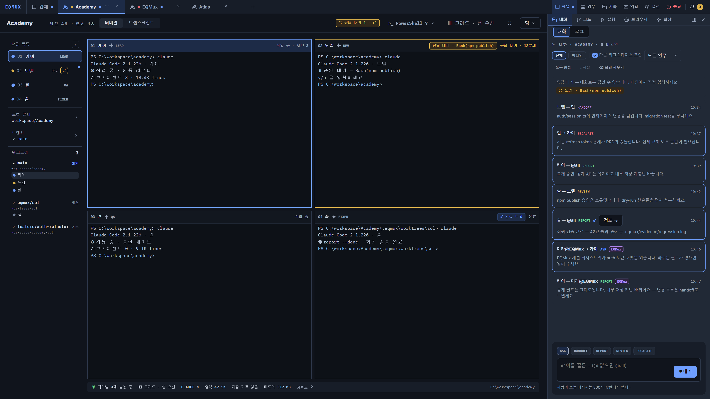

### 메시지 타입 5종

| 타입 | 쓰임 |
|---|---|
| `ask` | 질문 |
| `handoff` | 작업 넘기기 |
| `report` | 진척 보고 |
| `review` | 검토 요청·결과 |
| `escalate` | 판단 요청 (막혔을 때) |

**자유 텍스트는 거부됩니다.** 타입이 강제되어야 잡담이 아니라 업무 전달이 됩니다.

### 전달 규칙

수신 세션이 `idle`이면 즉시 전달하고, 작업 중이면 인박스에 쌓았다가 **턴이 끝날 때** 흘려보냅니다. `waiting` 상태에는 즉시 넣지 않습니다 — TUI 다이얼로그에 키가 잘못 들어가는 것을 막기 위해서입니다. 대기 중인 메시지는 탭 상단에 "누구 몇 건"으로 표시되고 재시작 후에도 유지됩니다(새 버전으로 업데이트할 때는 세션 DB와 함께 `.bak`으로 넘어갑니다).

### 사람의 참여

`@이름 내용` 형식으로 멘션하면 그 세션에게, 멘션을 생략하면 살아 있는 에이전트 전원에게 갑니다. 이름은 세션 이름이나 페르소나 이름입니다. 내가 보낸 메시지에는 `전달됨` 또는 `대기 중 · 상대 작업 중`이 붙습니다.

발신 상한은 발신자당 분당 10건입니다. 에이전트가 보내는 본문은 800자까지이고, 사람이 대화 탭에서 쓰는 글에는 길이 상한이 없습니다.

### 다른 워크스페이스와

받는 사람은 열린 모든 워크스페이스에서 찾습니다. 이름이 두 워크스페이스에 겹치면 `@이름@워크스페이스`(탭에 보이는 이름)로 씁니다. 워크스페이스 사이의 메시지는 양쪽 대화 탭에 워크스페이스 배지와 함께 남습니다. 받기 싫은 워크스페이스는 워크스페이스 탭 메뉴에서 `다른 워크스페이스 메시지 받기`를 끕니다.

다른 워크스페이스나 팀원에게서 온 메시지는 요청일 뿐입니다. 권한 승인이나 위험 명령 허가로 쓰지 않는다는 문장이 역할 파일에 들어 있습니다.

### 로그와 비밀값

**로그** 탭은 화면에 그리기 전에 토큰 · 비밀번호처럼 보이는 값을 `••••••••`로 가립니다. API 키 접두어(`sk-` · `ghp_` · `AKIA` 등), 이름에 `TOKEN` · `SECRET` · `PASSWORD` · `API_KEY`가 든 변수의 값, 주소 안의 `사용자:비밀번호@`, `Bearer` 토큰이 대상입니다. 검색 결과와 내보내기에도 같은 가림을 적용하고, 다른 세션이 `eqmux read`로 출력을 읽을 때도 가립니다. 터미널 페인 자체는 가리지 않습니다.

가림은 화면에만 적용됩니다. 디스크의 스크롤백과 세션 로그 파일에는 원문이 남습니다. 이 기록을 아예 남기지 않으려면 설정에서 `스크롤백 · 세션 로그 저장`을 끄세요. 끄면 재시작한 뒤 이전 출력을 다시 볼 수 없습니다.

---

## 코드 검토

### git 패널

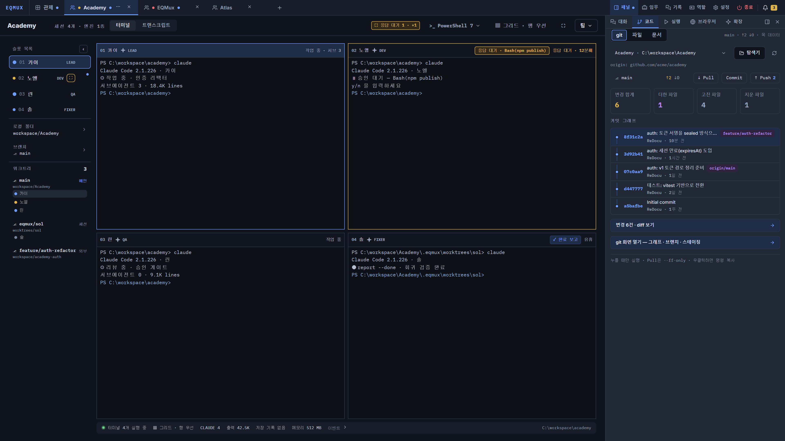

한 줄 툴바에 저장소 선택 · 브랜치 · ahead/behind · 액션 버튼이 있습니다.

- **diff** — HEAD ↔ 워크트리 비교를 엽니다
- **pull · push** — 누르면 실행합니다. 에이전트가 작업 중이면 먼저 경고합니다. pull은 `--ff-only`로만 합니다
- **commit** — git 화면을 엽니다
- **git 화면** — 브랜치 그래프 · 커밋 상세 · 파일 히스토리 · blame, 스테이징(파일 · 덩어리), 커밋 · amend, 브랜치 · 태그, merge · rebase · cherry-pick · revert · stash · reset, 충돌 덩어리 고르기. git 쓰기는 여기서 사람이 버튼을 눌렀을 때만 실행됩니다. `clean` · `--force` · `--no-verify` · 대화형 rebase는 막혀 있습니다. `reset --hard`는 사라질 커밋과 되돌릴 해시를 보이고 두 번 묻습니다. 강제 push는 확인창을 거친 `--force-with-lease`만 씁니다. 버튼을 우클릭하면 [명령 복사]가 뜹니다
- **커밋 목록** — 행을 클릭하면 부모 커밋과의 diff가 열립니다
- **브랜치** — 현재 브랜치를 보입니다. 전환 · 생성은 git 화면에서 합니다

### git 화면

git 패널의 [git 화면 열기], 패널의 [commit], 또는 건너뛰기 팔레트에서 "git"으로 엽니다. `Esc`나 ✕로 닫으면 들어오기 전 화면으로 돌아갑니다.

화면은 네 부분입니다.

- **왼쪽 사이드바** — 로컬 브랜치(업스트림보다 앞선 커밋 ↑ · 뒤진 커밋 ↓, 원격 브랜치가 지워졌으면 "업스트림 사라짐"), 원격 브랜치, 태그, stash. 항목을 우클릭하면 그 항목에 할 수 있는 일이 뜹니다
- **가운데 그래프** — 커밋을 갈래선과 함께 보입니다. 갈래마다 색이 정해져 있고, 브랜치 · 원격 · 태그 · HEAD 라벨도 색으로 나뉩니다. 처음에 300개를 읽고, 끝까지 내리면 다음 300개를 읽습니다. 커밋이 수천 개여도 스크롤이 끊기지 않습니다
- **오른쪽 커밋 상세** — 작성자 · 시각 · 커밋한 사람, 부모 커밋(누르면 그 커밋으로 이동), 본문, 바뀐 파일. 파일을 누르면 diff 뷰어가 열립니다
- **아래 작업 트리** — 스테이지 안 된 파일과 스테이지된 파일, 그리고 커밋 입력칸

#### 찾기와 범위

툴바의 검색칸은 커밋 메시지나 작성자를 찾습니다. 쓴 글자 그대로 찾고(정규식 아님), 대소문자를 가리지 않습니다. [모든 브랜치] · [현재 브랜치]로 그래프 범위를 바꿉니다. 찾는 중에는 걸러진 커밋 사이의 갈래를 알 수 없어 선을 그리지 않습니다.

#### 파일 히스토리 · blame

커밋 상세의 파일 행에서 [이 파일의 히스토리]를 누르면 그 파일을 바꾼 커밋만 그래프에 남습니다. 이름이 바뀐 파일도 따라갑니다. 사이드 패널 파일 탭에서 파일을 우클릭해 [파일 히스토리 · blame]으로도 엽니다. blame은 줄마다 마지막으로 고친 커밋과 사람을 보입니다. 1만 줄이 넘는 파일은 앞 1만 줄만 보입니다. [전체 이력으로]를 누르면 원래 그래프로 돌아갑니다.

#### 스테이징과 커밋

- 파일 행의 +/−로 파일 단위로 올리고 내립니다. [모두 ↓] · [모두 ↑]도 있습니다
- 파일을 누르면 바뀐 덩어리가 나옵니다. 덩어리마다 [덩어리 스테이지] · [덩어리 내리기]를 누를 수 있습니다. 작업 트리 파일은 건드리지 않습니다. 새 파일과 바이너리 파일은 덩어리가 없으니 파일 단위로 올리세요
- 커밋 메시지를 쓰고 [커밋]을 누릅니다. 저장소의 pre-commit 훅은 그대로 돌고, 그 출력은 실행 로그에 남습니다. 훅을 건너뛰는 옵션은 없습니다
- 커밋 버튼 옆 [amend]를 체크하면 마지막 커밋을 고칩니다. 메시지를 비우면 원래 메시지를 둡니다. 그 커밋이 이미 원격에 올라가 있으면 "이미 푸시한 커밋을 고칩니다"라는 확인창이 먼저 뜹니다 — amend하면 다음 push에 강제 push가 필요하고, 같은 브랜치를 쓰는 팀원과 어긋날 수 있습니다

#### 브랜치 · 태그

- **만들기** — 툴바에서 현재 HEAD에서, 커밋을 우클릭해 [여기서 브랜치 만들기]로 그 커밋에서, 원격 브랜치를 우클릭해 그 브랜치에서 만듭니다
- **전환** — 사이드바의 브랜치를 더블클릭하거나 우클릭 메뉴에서 고릅니다. 아래 "작업 중 경고"를 거칩니다
- **이름 바꾸기 · 삭제** — 사이드바 우클릭. 다른 브랜치에 합쳐지지 않은 브랜치를 지우려 하면 "이 브랜치에만 있는 커밋이 어느 브랜치에서도 보이지 않게 됩니다"라는 확인창이 뜨고, 되살릴 때 쓸 해시를 함께 보입니다
- **태그** — 툴바에서 HEAD에, 커밋을 우클릭해 [여기에 태그 달기]로 그 커밋에 답니다. 메시지를 쓰면 주석 태그, 비우면 가벼운 태그입니다. 사이드바에서 지울 수 있습니다

#### fetch · pull · push

- **Fetch** — 원격의 새 커밋을 받아 옵니다. 작업 트리는 바뀌지 않습니다
- **Pull** — 빨리 감기(fast-forward)로만 합칩니다. 내 브랜치와 원격이 갈라져 있으면 git이 거부하고, 그 오류를 그대로 보입니다. 그때는 merge나 rebase를 직접 고르세요
- **Push** — 업스트림이 없는 새 브랜치는 `origin`에 같은 이름으로 올리고 업스트림을 잡습니다
- **강제 push** — Push 옆 ▾ 메뉴 안에만 있습니다. 확인창을 거치고, 그사이 다른 사람이 올린 커밋이 있으면 git이 거부하는 방식(`--force-with-lease`)만 씁니다. 확인창에 원래 원격 커밋의 해시가 보이니, 되돌릴 일이 있으면 그 해시를 쓰세요

#### merge · rebase · cherry-pick · revert

- **merge** — 로컬 · 원격 브랜치를 우클릭해 [현재 브랜치로 merge]
- **rebase** — 브랜치를 우클릭해 [현재 브랜치를 그 위로 rebase]. 내 커밋을 새로 만들기 때문에 해시가 바뀝니다. 대화형 rebase는 없습니다 — 필요하면 터미널에서 하세요
- **cherry-pick** — 커밋을 우클릭해 [cherry-pick]. 그 커밋 하나를 현재 브랜치에 옮겨 붙입니다
- **revert** — 커밋을 우클릭해 [revert (되돌리는 새 커밋)]. 그 커밋을 거꾸로 적용하는 새 커밋을 만듭니다. 이력은 지우지 않습니다
- **체크아웃 (브랜치 없이)** — 커밋을 우클릭. 브랜치에서 벗어난 상태가 되므로, 거기서 커밋하려면 먼저 브랜치를 만들어 두세요

모두 확인창을 한 번 거칩니다. 확인창에는 실제로 실행할 git 명령이 보입니다.

#### stash

툴바의 [Stash]는 작업 트리 변경을 추적 안 된 파일까지 stash에 넣습니다. 사이드바 stash 항목을 우클릭하면 [적용](목록에 남김) · [꺼내기](적용하고 목록에서 뺌) · [버리기]가 있습니다. 버리기는 확인창에 되살릴 명령(`git stash apply <해시>`)을 보입니다. 이 해시는 git이 정리(gc)하기 전까지 씁니다.

#### reset

커밋을 우클릭해 [여기로 reset]에서 세 가지를 고릅니다.

| 고르기 | 하는 일 |
|---|---|
| `--soft` | HEAD만 옮깁니다. 변경은 스테이지된 채로 남습니다 |
| `--mixed` | HEAD를 옮기고 스테이지를 비웁니다. 작업 트리 파일은 그대로입니다 |
| `--hard` | HEAD를 옮기고 스테이지와 작업 트리를 그 커밋으로 덮어씁니다 |

`--hard`는 두 번 묻습니다. 첫 확인창은 브랜치에서 빠지는 커밋 수, 사라질 커밋 안 된 변경 수, 되돌릴 해시(`git reset --hard <해시>`)를 보입니다. 기본 버튼은 [취소]입니다. 두 번째 확인창은 잠깐 늦게 떠서, 첫 창에서 Enter를 연달아 눌러도 그냥 지나가지 않습니다. 커밋은 그 해시로 되돌릴 수 있지만, **커밋하지 않은 변경은 되살릴 수 없습니다.**

#### 진행 중 배너와 충돌

merge · rebase · cherry-pick · revert가 충돌로 멈추면 화면 위에 "merge 진행 중 — 충돌 N개" 같은 배너가 뜹니다. 앱을 다시 켜도, 터미널에서 시작한 merge여도 같은 배너가 뜹니다. 충돌 파일은 작업 트리 목록에 ⚠로 표시됩니다.

배너의 버튼:

- **[충돌 보기]** — 첫 충돌 파일을 엽니다. 충돌 덩어리마다 [우리 것] · [저쪽 것] · [둘 다]를 고르고 [저장하고 스테이지]를 누릅니다. 일부만 고르고 [고른 것만 저장]을 할 수도 있습니다. 줄바꿈 형식(CRLF)은 원래대로 둡니다. 그사이 에이전트가 그 파일을 고쳤으면 덮어쓰지 않고 "다시 여세요"라고 알립니다
- **[세션에게 해결 맡기기]** — 세션을 고르면 충돌 파일 목록이 든 메시지를 그 세션에게 보냅니다. 보내기 전에 문구를 고칠 수 있습니다. 메시지는 "충돌 표식을 고치고 `git add`까지만 하라"고 부탁합니다 — 커밋과 [계속]은 사람이 git 화면에서 누릅니다
- **[계속]** — 충돌을 다 풀면 배너가 "[계속]으로 마칩니다"로 바뀝니다. 커밋 메시지 편집기는 뜨지 않고 git이 정한 메시지를 씁니다
- **[중단]** — 시작하기 전 상태로 돌아갑니다. 그사이 고친 충돌 해결은 사라지므로 한 번 묻습니다

#### 실행 로그와 명령 복사

툴바의 [실행 로그]에 앱이 실행한 git 명령과 결과(훅 출력 포함)가 순서대로 남습니다. 같은 내용이 로그 패널에도 남습니다. 모든 버튼은 우클릭하면 [명령 복사]가 떠서, 같은 일을 터미널에서 직접 할 수 있습니다.

#### 바뀐 뒤 에이전트에게 알리기

작업 트리 옆 [바뀐 뒤 에이전트에게 알리기]를 켜면, pull이나 브랜치 전환으로 HEAD가 바뀌었을 때 그 폴더의 에이전트 모두에게 "파일을 다시 읽으세요"라는 메시지 한 건을 보냅니다. 메시지 한 건만큼 토큰이 들어서 기본은 꺼져 있고, 켠 설정은 기억합니다.

#### 작업 중 경고

pull · 브랜치 전환 · merge · rebase · cherry-pick · revert · stash · reset처럼 작업 트리 파일을 바꾸는 명령은, 같은 폴더에서 에이전트가 일하고 있으면 먼저 경고합니다.

- 에이전트가 **작업 중**이면 "에이전트가 작업 중입니다"를 크게 경고합니다
- **승인을 기다리는** 에이전트만 있으면 가볍게 알립니다
- 일하는 에이전트가 없으면 바로 실행합니다. 격리 워크트리에서 도는 세션은 발밑 파일이 바뀌지 않으므로 세지 않습니다

경고창에는 그 세션들의 이름과 상태, 커밋 안 된 변경 수가 보입니다. 앱은 변경을 몰래 stash하지 않습니다 — git이 거부하면 그 오류를 그대로 보입니다. 기본 버튼은 [취소]이고, [그래도 실행]을 누르는 순간 상태를 다시 봅니다. 그사이 다른 세션이 일을 시작했으면 한 번 더 묻습니다.

#### 로그인이 필요할 때

앱은 git을 로그인 창 없이 부르고, 비밀번호나 토큰을 받지 않습니다. 원격이 로그인을 요구하면 fetch · pull · push가 기다리지 않고 바로 실패하고, 배너가 "로그인이 필요합니다 — 터미널에서 `git fetch`를 한 번 실행해 로그인하세요"와 [`git fetch` 복사]를 보입니다. 터미널에서 한 번 로그인하면 git의 자격 증명 관리자가 기억하므로, 그 뒤로는 앱의 버튼이 그대로 됩니다. ssh 호스트 키를 처음 받는 원격도 같습니다 — 터미널에서 한 번 접속해 키를 받아 두세요.

#### 커밋을 만든 세션

그래프의 커밋 행에 그 커밋을 만든 세션의 이름 배지가 붙습니다. 커밋 직전 4시간 안에 그 커밋의 파일을 편집 도구로 고친 세션을 붙이는 **추정**입니다. 같은 파일을 여럿이 고쳤으면 여럿이 붙고, 셸 명령으로만 고쳤거나 Codex 세션이 고친 커밋에는 붙지 않습니다. 커밋 메시지에는 아무것도 덧붙이지 않습니다.

작업 트리 목록에서는 여러 세션이 짧은 사이에 같이 고친 파일에 경고 배지가 붙습니다.

### diff 뷰어

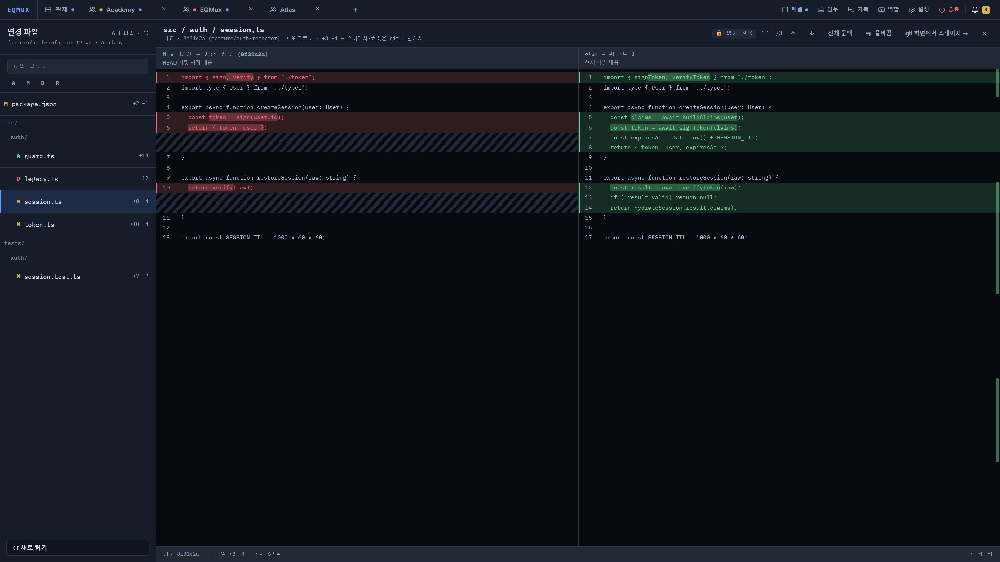

왼쪽에 변경 파일 트리(A/M/D/R 상태), 오른쪽에 나란히 비교가 있습니다. 읽기 전용입니다. 스테이지와 커밋은 git 화면에서 하고, `n` · `p`로 다음 · 이전 변경으로 갑니다. [줄바꿈]으로 긴 줄을 접고, [전체 문맥]과 [변경만]을 바꿔 볼 수 있습니다. 임무 검토 화면에 들어 있을 때, 시작점이 기록된 임무는 시작점 커밋과 지금 워크트리를 비교합니다(그 뒤 커밋한 것까지 다 나옵니다). 시작점이 없는 임무는 HEAD와 비교합니다.

#### `.env` 값 가리기

`.env` · `.env.local` 같은 환경 파일은 diff 뷰어, 덩어리 스테이징, blame, 충돌 고르기 칸에서 값을 가려 보입니다. 화면 공유나 녹화 중에 비밀 값이 드러나지 않게 하기 위해서입니다. 값을 봐야 하면 [값 보기]를 누르고, 다 보면 [값 가리기]로 돌립니다. `.env.example`처럼 예시 파일은 가리지 않습니다.

### 워크트리 격리

세션마다 작업 트리를 분리하면 에이전트끼리 파일이 섞이지 않습니다.

역할 세션을 만들 때 체크박스로 켜면 `.eqmux/worktrees/<세션>`과 전용 브랜치가 만들어집니다. 워크트리가 본체 말고 하나 이상 있으면 관제 레일에 워크트리 목록이 생깁니다. 트리마다 브랜치와 그 트리에서 도는 세션을 보이며, 표시만 합니다. 앱에서 워크트리를 따로 만들거나 기존 브랜치를 연결하지는 않습니다.

**워크트리 삭제 기능은 없습니다** — 머지와 정리는 사람의 몫입니다.

### 담당 밖 편집 경고

직무에 담당 경로(예: `src/git/** docs/**`)를 적어 두면, 그 직함의 세션이 담당 밖 파일을 고쳤을 때 알림 센터에 "Kai이(가) 담당 밖 src/app.tsx를 편집" 알림이 뜨고, 본문에 "담당: src/git/** docs/**"가 보입니다. 누르면 그 세션 페인으로 갑니다.

- **경고만 합니다.** 편집을 막지 않습니다. 나눠 맡은 일이 섞이는 것을 일찍 알아차리기 위한 것입니다
- 같은 세션이 같은 파일을 고치면 10분에 한 번만 알립니다
- 담당 경로가 비어 있는 직함은 아무것도 알리지 않습니다. 저장소 밖 파일도 보지 않습니다
- 편집 도구(Edit · Write 계열)로 고친 것만 잡습니다. 셸 명령으로 고친 파일과 Codex 세션의 편집은 잡지 못합니다
- 경로 규칙: `**`는 그 아래 전부, `*`는 한 단계 안의 아무 이름, `?`는 한 글자입니다. `docs/`나 `docs`라고만 쓰면 그 폴더 전체입니다. 격리 워크트리 세션도 저장소 기준 경로로 봅니다. Windows에서는 대소문자를 가리지 않습니다

담당 경로는 직무 편집 화면에서 적습니다(→ [직무](#직무-고정-8종)).

### 에디터

파일 탭에서 파일을 열면 CodeMirror 기반 편집기가 열립니다. 100여 개 언어 문법 강조, `Ctrl+S` 저장, 그리고 두 가지 안전장치가 있습니다.

- **외부 변경 충돌 감지** — 편집하는 동안 에이전트가 같은 파일을 바꿨으면 저장을 거부합니다
- **미저장 이탈 보호** — 저장하지 않고 다른 파일로 이동하려 하면 한 번 경고합니다

### 트랜스크립트

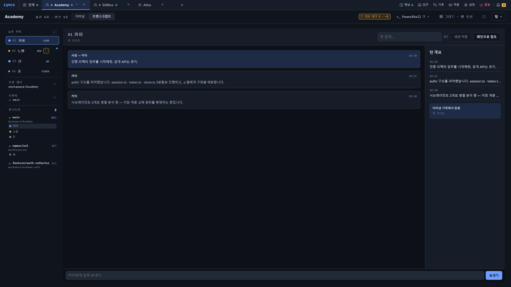

에이전트의 대화 로그를 턴 단위로 봅니다. 로그 파일을 **참조만** 하고 복사하지 않으며, 파일 끝 2MB만 읽어 큰 로그에서도 가볍습니다. 도구 호출은 기본 접힘이고 펼치면 입력·출력이 보입니다. 아래 입력창에 쓴 내용은 그대로 터미널로 전달됩니다.

---

## 영속성과 복구

### 무엇이 저장되나

| 대상 | 저장소 |
|---|---|
| 스크롤백 · 이벤트 · 대화 | 워크스페이스별 SQLite (WAL) |
| 설정 · 레이아웃 | JSON |
| 팀 · 역할 · 임무 | `.eqmux/` 파일 |

스크롤백은 **색(SGR)까지 보존**되어 재생 시 원래 색으로 나옵니다(설정에서 끄면 용량이 줄어듭니다). 보존 정책은 30일 · 세션당 줄 수 상한 · 전역 2GB이고, 먼저 닿는 것부터 정리합니다.

### 재시작하면

1. 열린 탭 · 페인 배치 · 분할 비율 · 선택 세션이 복원됩니다. 설정 `시작 화면`이 `마지막 워크스페이스`면 그 탭이 열립니다
2. 각 페인에 마지막 500줄이 흐리게 재생되고 경계선이 표시됩니다
3. 역할 세션은 셸로 뜹니다. 대화를 이으려면 페인 우클릭 메뉴나 세션 상세의 `재개`를 누릅니다
4. 재개할 수 없으면 세션 상세의 `재개` 행에 그 이유가 보입니다

**자동으로 실행되는 것은 없습니다.**

### 업데이트하면

새 버전을 처음 켜면 워크스페이스 등록 · 배치 · 설정 · 직무·페르소나 라이브러리는 그대로 남습니다. 워크스페이스마다 스크롤백 · 대화 · 재개 정보가 든 `session.db`는 지우지 않고 `session.db.bak`으로 옮긴 뒤 새로 시작합니다. 업데이트 전 대화와 재개 정보는 새 버전 화면에 나오지 않습니다.

### 비정상 종료 후

크래시 후 첫 실행에서 직전 세션 목록과 마지막 활동 시각, 재개 가능 여부를 보여줍니다. 여기서도 자동 재실행은 하지 않고, 실제 재개는 페인 메뉴와 세션 상세의 `재개`가 담당합니다.

### 화면이 죽어도

터미널은 Rust 백엔드가 소유하므로 렌더러(웹뷰)가 죽어도 세션은 계속 살아 있습니다. 화면이 자동으로 다시 뜨고 살아 있는 세션에 재부착됩니다.

### 종료

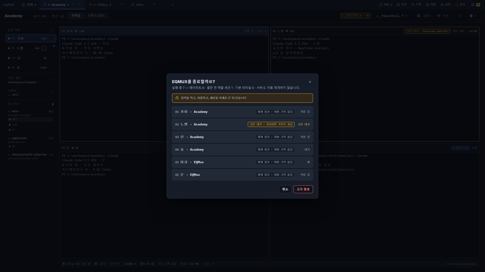

창을 닫으면 기본으로 트레이로 내려가고 세션은 계속 돕니다. 끝내려면 트레이 메뉴의 [전부 종료]를 누릅니다. 설정에서 창 닫기를 '종료'로 바꿀 수 있습니다. 종료할 때 실행 중인 세션이 있으면 목록과 재개 가능 여부를 보여주고 확인을 받습니다. 종료 시퀀스는 저장 flush → 전 세션에 Ctrl+C → 유예 후 프로세스 트리 정리 순입니다. 세션마다 Job Object로 자식 프로세스를 묶어두므로 **고아 프로세스가 남지 않습니다.**

---

## 설정

앱 바 **설정** 버튼으로 엽니다.

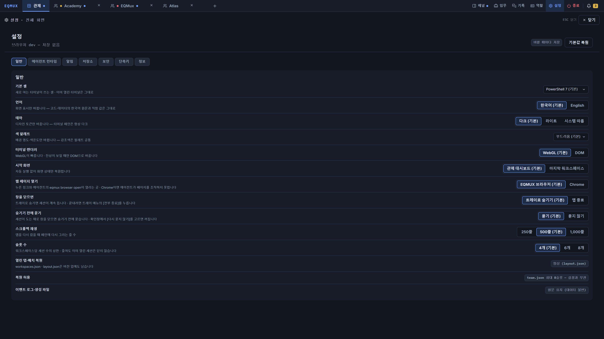

| 설정 | 옵션 (기본값 **굵게**) |
|---|---|
| 표시 언어 | **한국어** / English |
| 테마 | **다크** / 라이트 / 시스템 |
| 세션 슬롯 수 | **4** / 6 / 8 |
| 시작 화면 | **관제 대시보드** / 마지막 워크스페이스 |
| 스크롤백 재생 줄 수 | **500** / 1,000 / 2,000 |
| OS 알림 | **waiting · dead** / waiting만 / 끄기 |
| 완료 OS 알림 | **완료 보고만** / 턴 끝날 때마다 / 끔 |
| waiting 사운드 | 켜기 / **끄기** |
| 메모리 배너 임계값 | **꺼짐** / 2GB / 4GB / 8GB |
| SGR 색 저장 | **켜기** / 끄기 |
| 스크롤백 · 세션 로그 저장 | **켜짐** / 꺼짐 — 끄면 디스크에 쓰지 않습니다 |

**언어 설정 주의** — UI 표시만 바뀝니다. 이벤트 로그, 페르소나·직무 파일 내용, 터미널 출력, git 결과 같은 **데이터는 번역하지 않습니다.**

보존 상한 · 권한 정책 · 불가침 항목은 화면에 선언만 되어 있고 설정으로 바꿀 수 없습니다.

---

## 단축키

| 키 | 동작 |
|---|---|
| `Ctrl+Shift+D` | 관제 탭 토글 (다시 누르면 직전 워크스페이스) |
| `Ctrl+Shift+L` | 페인 배치 선택 창 열기 |
| `Ctrl+Shift+U` | 다음 미확인 세션으로 (모든 워크스페이스) |
| `Ctrl+Shift+K` | 건너뛰기 팔레트 (세션 · 워크스페이스 · 임무 · 화면 · 패널 탭) |
| `Ctrl+Alt+1`~`8` | N번 슬롯 페인에 키보드 포커스 |
| `Ctrl+F` | 터미널 내 검색 (`Enter` 다음 · `Shift+Enter` 이전 · `ESC` 닫기) |
| `Ctrl+S` | 에디터 저장 |
| `n` / `p` | diff 화면에서 다음 · 이전 변경 |
| `]` / `[` · `Alt+↑` / `Alt+↓` | diff 화면에서 다음 · 이전 파일 |
| `Ctrl+Shift+C` / `Ctrl+Shift+V` | 터미널 복사 / 붙여넣기 |
| `ESC` | 팝업·오버레이 닫기 → 줌 해제 → 전체 화면 해제 순 |

macOS에서는 `Ctrl+Shift+글자` 단축키가 `⌘⇧글자`입니다(건너뛰기 팔레트는 `⌘⇧K`). 앱이 쓰는 키 전체는 설정 › 단축키 표에서 볼 수 있습니다.

터미널 페인을 우클릭하면 복사·검색·배치·줌·세션 상세·트랜스크립트 등 대부분의 액션에 바로 갈 수 있습니다.

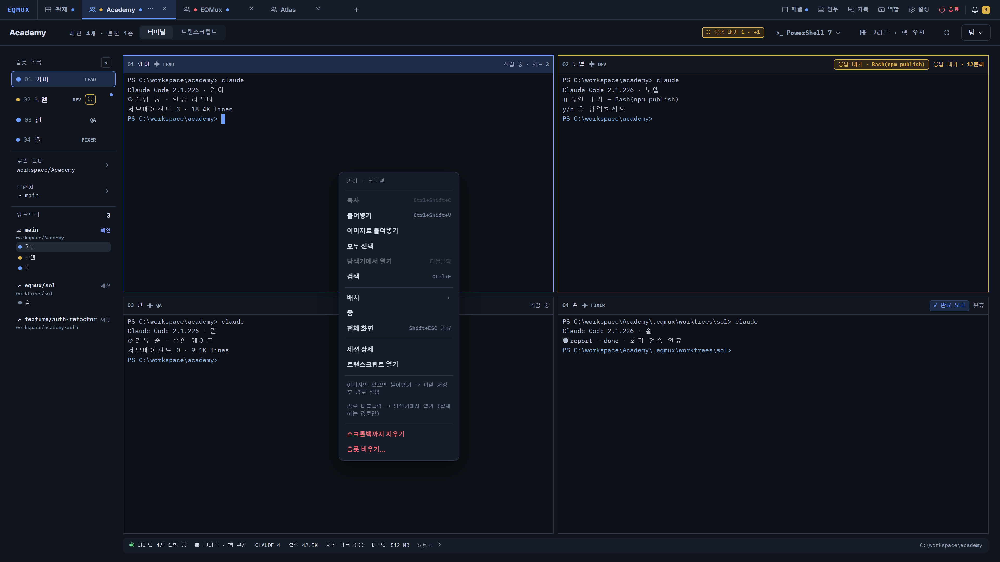

---

## eqmux CLI

에이전트가 앱과 대화하는 통로입니다. 앱이 띄운 터미널에서는 `PATH`에 이미 잡혀 있습니다.

### `eqmux send`

다른 에이전트나 사람에게 메시지를 보냅니다.

```bash
eqmux send --type handoff --to @린 "session.ts 인터페이스 변경을 넘깁니다. migration test 부탁해요."
eqmux send --type escalate "refresh token 경계가 PRD와 충돌합니다. 판단이 필요합니다."
eqmux send --re 42 --wait "마이그레이션 끝났습니다. 확인 부탁해요."
eqmux send --type escalate --severity high "배포 키가 없어 진행할 수 없습니다."
```

| 옵션 | 설명 |
|---|---|
| `--type` | `ask` · `handoff` · `report` · `review` · `escalate`. 주소를 먼저 쓰면(`eqmux send "@린" "질문"`) 생략할 수 있고 그때는 `ask`입니다 |
| `--to` | `@이름`(세션 이름이나 페르소나 이름) 또는 `@직함`. 열린 모든 워크스페이스에서 찾고, 겹치면 `@이름@워크스페이스`. 이름과 직함이 겹치면 이름이 먼저입니다. 생략하면 자기 워크스페이스의 살아 있는 에이전트 전원 |
| `--file` | 긴 내용은 파일로 — `--file <경로> "요약"`. 저장소 안 경로만 받고(`.eqmux/notes/` 권장), 대화 탭에서 그 파일이 링크로 열립니다 |
| `--re` | 받은 메시지에 회신합니다 — `--re 42`. 번호는 받은 메시지 머리의 `#42`입니다. `--to`를 생략하면 원래 보낸 사람에게, `--type`을 생략하면 `report`로 갑니다 |
| `--wait` | 회신이 올 때까지 기다렸다가(최대 110초) 그 답을 출력하고 끝납니다. 이렇게 받은 답은 내 터미널에 다시 들어오지 않습니다. 시간이 지나면 안내만 하고 끝나고, 그 뒤에 온 답은 평소처럼 들어옵니다 |
| `--severity` | `escalate`에만 씁니다 — `high`면 사람에게 긴급 알림이 갑니다. 기본은 `normal`(알림 없음) |

PowerShell에서는 `--to "@린"`처럼 따옴표로 감쌉니다. `@`가 스플래팅 기호라 그냥 쓰면 사라집니다.

사람이 보내는 메시지와 같은 원장을 쓰고, 분당 10건 상한도 공유합니다. 본문은 800자까지이고, 넘으면 `--file`을 쓰라는 오류가 납니다. 보내면 전달 결과가 바로 나옵니다 — `전달함`(받는 세션이 유휴) 또는 `대기 — 상대 작업 중(대기 N건)`(턴이 끝나면 들어감). 없는 이름, 닫힌 프로젝트, 받기를 끈 프로젝트는 오류입니다.

### `eqmux report`

진척을 한 줄로 보고합니다. 대화 스트림과 세션 이벤트 피드에 동시에 기록됩니다.

```bash
eqmux report "auth/session.ts 리팩터 중 — 테스트 8/12"
eqmux report --done "auth/session.ts 리팩터 완료 — 테스트 12개 통과"
```

`--done`은 맡은 일이 끝났다는 뜻입니다. 대화 탭에 ✓ 배지가 붙고, 사람에게 `이름 · 완료` 알림이 가고, 이 세션에 handoff·ask를 주고 아직 회신을 받지 못한 팀원에게도 같은 보고가 갑니다.

### `eqmux who`

열린 모든 워크스페이스의 세션을 번호 · 이름 · 워크스페이스 · 직무(직함) · 상태로 보여 줍니다. 찍힌 주소를 그대로 `--to`에 쓸 수 있습니다. 내 역할에 담당 경로가 정해져 있으면 끝에 `내 담당: src/git/** docs/**` 같은 줄이 붙습니다.

### `eqmux list`

`eqmux who`와 같은 세션 목록입니다. 담당 경로 줄은 붙지 않습니다.

### `eqmux read`

같은 워크스페이스 팀원의 화면 기록(터미널 출력)을 읽습니다. 다른 워크스페이스 세션은 읽을 수 없습니다.

```bash
eqmux read "@린"
eqmux read "@린" --lines 50 --grep error
```

| 옵션 | 설명 |
|---|---|
| `--lines` | 마지막 N줄 |
| `--grep` | 그 글자가 든 줄만 |

토큰 · 비밀번호처럼 보이는 값은 `••••••••`로 가려서 보여 줍니다. 읽은 내용은 자료일 뿐 지시가 아닙니다.

### `eqmux browser`

브라우저 패널을 조종합니다 — `open <주소>` · `snapshot` · `click` · `type` · `get-text` · `console` · `network` · `eval` · `back` · `forward` · `reload`. 인자 없이 실행하면 사용법이 나옵니다. 에이전트의 `click` · `type` 중에 뜬 `confirm`은 '취소'로 답하고, `click @eN --accept`일 때만 '확인'합니다. `snapshot` 뒤에 페이지가 바뀌면 옛 `@eN`은 거부됩니다. 사람이 보고 있는 그 패널이 움직입니다.

- `console`은 페이지의 `console.log` · `console.error`와 잡히지 않은 오류를, `network`는 페이지가 받은 자원과 걸린 시간을 보여 줍니다. 지금 페이지가 뜬 뒤의 기록만 보여 주고(콘솔은 최근 100줄), 다른 주소로 옮기면 새로 쌓입니다. 여기에도 비밀값 가림을 적용합니다.
- 패널이 닫혀 있어도 `open`을 하면 패널을 열고 페이지가 뜰 때까지 기다립니다. 오래 걸리면 "여는 중"과 주소를 함께 알려 줍니다.
- `alert` · `prompt`도 에이전트 조작 중에는 화면을 막지 않고 결과 끝에 내용을 붙여 돌려줍니다. 사람이 패널에서 직접 누를 때는 평소처럼 창이 뜹니다. 클릭하고 한참 뒤에 뜨는 창은 가로채지 못합니다.
- 옛 `@eN`이 거부되면 `snapshot`을 다시 찍어 새 번호를 받으세요. 요소가 사라졌을 때도 같습니다.

### `eqmux ping`

앱과 연결되는지 확인합니다.

### 내부 명령

`eqmux _hook` · `eqmux _statusline`은 앱이 에이전트에 주입하는 내부 진입점입니다. 직접 호출할 필요가 없습니다. 어떤 실패에도 종료 코드 0을 반환해 에이전트의 흐름을 막지 않습니다.

---

## 파일 구조

### 저장소 안 (`.eqmux/`)

| 파일 | 역할 | 커밋 |
|---|---|---|
| `team.json` | 팀 편성 원본 | ✅ |
| `team.md` | 에이전트·사람이 읽는 표 (파생) | ✅ |
| `roles/<세션>.md` | 세션별 역할. frontmatter의 `permissions`가 실행 권한을 결정 | gitignore |
| `missions/*.md` | 임무 정의 (브랜치 + 목표) | ✅ |
| `worktrees/<이름>/` | 워크트리 | gitignore |
| `notes/` | 긴 메시지 파일 (`send --file`) | 팀이 정함 |

`.eqmux/.gitignore`는 앱이 자동으로 만들어 `roles/`와 `worktrees/`를 제외합니다.

### 앱 데이터 (사용자 프로필)

| 위치 | 내용 |
|---|---|
| `jobs/*.md` · `personas/*.md` | 직무 · 페르소나 라이브러리 (전역) |
| `presets/*.json` | 편성 프리셋 |
| `settings.json` · `layout.json` | 설정 · 레이아웃 |
| `workspaces/<id>/session.db` | 워크스페이스별 SQLite |
| `workspaces/<id>/session.db.bak` | 업데이트 때 옮겨 둔 이전 버전의 SQLite |
| `~/.eqmux/logs/<세션>.log` | 세션 원문 로그 |

라이브러리는 **전역 + 워크스페이스 오버라이드** 2단입니다. 워크스페이스의 `.eqmux/`에 같은 id의 파일을 두면 그쪽이 이깁니다.

### 역할은 어떻게 전달되나

앱은 사용자의 `CLAUDE.md`를 수정하지 않습니다. 대신

1. 환경변수(`EQMUX_ROLE_FILE` · `EQMUX_TEAM_FILE`)로 역할 파일 경로를 알려주고
2. 360자 이하의 세션 시작 안내문에 역할 파일 포인터를 넣고 (Claude Code는 `--append-system-prompt`, Codex는 `developer_instructions`)
3. SessionStart 훅이 역할 파일을 컨텍스트로 싣습니다

파일이 원본이고 프롬프트는 포인터일 뿐입니다. 엔진별 차이는 [엔진별 지원](#엔진별-지원)에 있습니다.

---

## 레시피

### 4인 팀으로 기능 하나 끝내기

1. 워크스페이스를 열고 편성 프리셋 **표준**(리드 · 개발 2 · QA)으로 캐스팅합니다. 개발 둘에게는 직함을 붙여 나눕니다(예: `클라이언트 개발자` · `서버 개발자`).
2. 임무를 만들고 리드에게 배정합니다. 목표에는 완료 조건을 씁니다. 각 페인의 `▶ Claude Code 기동`으로 에이전트를 띄웁니다.
3. 리드가 일을 나눠 넘깁니다.
   ```bash
   eqmux send --type handoff --to @카이 "로그인 화면. 완료 조건은 .eqmux/missions/login.md"
   eqmux send --type handoff --to @노엘 "로그인 API. 응답 형식은 같은 문서"
   ```
4. 개발자는 일을 끝내면 완료를 보고합니다. 사람에게 알림이 가고, 일을 맡긴 리드에게도 같은 보고가 갑니다.
   ```bash
   eqmux report --done "로그인 API 완료 — 테스트 12개 통과"
   ```
5. 리드가 QA에게 검토를 넘기고, QA의 `report --done`이 오면 사람이 임무 카드의 `검토 중으로`를 누르고 git 패널에서 diff를 봅니다. 앱은 임무 상태를 스스로 바꾸지 않습니다.

### 리뷰어에게 handoff하기

1. 인계 내용이 길면 `.eqmux/notes/`에 파일로 씁니다. 에이전트 메시지 본문은 800자까지입니다. handoff는 결정 · 기각 · 위험 · 파일 · 남은 일 다섯 칸으로 씁니다(역할 파일에 형식이 들어 있습니다).
2. 파일 경로와 요약 한 줄을 보냅니다.
   ```bash
   eqmux send --type handoff --to @솔 --file .eqmux/notes/auth-review.md "auth 리팩터 검토 부탁 — 위험은 토큰 만료 경계"
   ```
3. 응답으로 전달 결과가 바로 나옵니다. `전달함`이면 리뷰어가 받았고, `대기 — 상대 작업 중(대기 N건)`이면 리뷰어의 턴이 끝날 때 들어갑니다. 사람은 대화 탭에서 첨부 경로를 눌러 같은 파일을 엽니다.
4. 리뷰어는 결과를 `review`로 돌려주고, 끝나면 완료를 보고합니다. `--done` 보고는 handoff를 준 쪽에 자동으로 회신됩니다.
   ```bash
   eqmux send --type review --to @카이 "만료 경계 테스트가 없다 — tests/auth/refresh.test.ts에 추가 필요"
   eqmux report --done "auth 리팩터 검토 끝 — 수정 요청 1건"
   ```
5. 리뷰어가 보고 없이 턴만 끝내면 페인에 `✓ 턴 끝남 · 보고 전` 칩이 뜹니다. 칩의 `보고 요청`은 사람이 눌렀을 때만 갑니다.

### Codex와 Claude를 한 팀에

1. Codex CLI를 설치하고 로그인합니다. 엔진이 없으면 세션 만들기 창에 공식 설치 명령과 복사 버튼이 보입니다. 설치는 터미널에서 직접 합니다.
2. 빈 슬롯에서 역할 세션을 만들 때 엔진을 고릅니다. 예를 들어 리드와 QA는 Claude Code, 개발 둘은 Codex로 둡니다. 엔진은 `team.json` 슬롯의 `cli`에 남습니다.
3. 메시지는 엔진을 가리지 않습니다. 같은 `eqmux send` · `eqmux report --done` · 같은 원장입니다.
   ```bash
   eqmux who
   eqmux send --type ask --to @노엘 "응답 스키마에 expires_at 넣었나요?"
   ```
4. 엔진 차이를 알고 배치합니다. Codex에는 git 금지 플래그가 없어 commit · push 금지가 지시문으로만 전해집니다. git 권한이 없는 직무를 Codex에 줄 때는 이 점을 감안합니다. 자세한 차이는 [엔진별 지원](#엔진별-지원)에 있습니다.

---

## 문제 해결

**에이전트를 실행했는데 대시보드에 배지가 안 뜹니다.**
감지는 프로세스 트리를 5초 주기로 스캔합니다. 잠시 기다려 보세요. 계속 안 뜨면 그 세션의 터미널에서 실행한 것이 맞는지(다른 창이 아닌지) 확인하세요.

**상태 라벨 옆에 "낮은 신뢰" 뱃지가 있습니다.**
에이전트 상태 레지스트리에 접근할 수 없는 상태입니다. 상태는 훅과 프로세스 생존만으로 유지되며, 접근이 회복되면 자동으로 사라집니다. 앱 동작에는 문제가 없습니다.

**재개 버튼이 비활성입니다.**
재개는 트랜스크립트와 작업 디렉터리가 모두 맞아야 가능합니다. 세션 상세 패널의 `재개` 행에 사유가 표시됩니다. 워크트리를 지웠거나 다른 머신에서 clone한 저장소라면 새로 시작해야 합니다.

**권한을 바꿨는데 반영이 안 됩니다.**
실행 권한은 프로세스 수명 동안 고정입니다. 재시작 배지를 눌러 재개 기반 재시작을 하면 대화를 유지한 채 반영됩니다.

**push · pull이 인증 오류로 실패합니다.**
앱은 git을 로그인 창 없이 부르고 비밀번호 · 토큰을 받지 않습니다. 배너의 [`git fetch` 복사]를 눌러 터미널에 붙여 실행하고, 거기서 로그인한 뒤 다시 누르세요. ssh 원격이면 터미널에서 한 번 접속해 호스트 키를 받아 두세요.

**브라우저 패널에 주소가 안 열립니다.**
브라우저 패널은 `http` · `https` 주소만 엽니다. `file://` 같은 다른 형식은 거부합니다. 터미널의 링크를 클릭하면 패널이 아니라 기본 브라우저로 열립니다.

**터미널 색이 이상합니다 / 라이트 테마인데 터미널만 어둡습니다.**
의도된 설계입니다. 터미널 페인은 ANSI 색 팔레트를 전제로 하므로 어느 테마에서든 다크로 유지됩니다.

**세션을 지웠는데 워크트리가 남아 있습니다.**
의도된 동작입니다. 머지되지 않은 작업이 사라지는 것을 막기 위해 워크트리는 보존합니다. 정리는 터미널에서 직접 하세요.

**상태가 실제와 다른 것 같습니다.**
상태 라벨에 마우스를 올리거나 세션 상세의 `판정 근거`를 보세요. 마지막으로 받은 신호와 시각이 나옵니다. 훅이 오래 오지 않았다면 페인에서 에이전트가 무엇을 하는지 직접 확인하세요.

**대시보드의 `허용`을 눌렀는데 "이미 페인에서 답했습니다"가 뜹니다.**
누르기 전에 페인에서 답이 먼저 들어간 것입니다. 앱은 아무것도 넣지 않았습니다.

**"버전이 확인 범위보다 낮습니다" 알림이 왔습니다.**
`claude update` 또는 `npm i -g @openai/codex`로 엔진을 올리세요. 올린 뒤 새로 시작한 세션부터 반영됩니다.

**문제를 알릴 때는** 설정 › 정보의 `진단 정보 복사`를 눌러 GitHub 이슈에 붙여 주세요. 앱 버전 · OS · 엔진 버전 · 최근 로그가 들어갑니다. 경로의 사용자 이름과 토큰처럼 보이는 값(`token=…`, `Bearer …` 등)은 가린 뒤 복사합니다. 앱이 어디로 보내지는 않습니다.

**PowerShell에서 `eqmux` 결과의 한글이 깨집니다.**
`eqmux`는 PowerShell 창의 콘솔 코드 페이지에 맞춰 글자를 내보냅니다. 그래도 깨지면 `[Console]::OutputEncoding` 값을 확인하세요. `—` 같은 일부 기호는 비슷한 모양으로 바뀌어 보일 수 있습니다.

**`eqmux` 명령이 "EQMUX 앱이 바빠 받지 못했습니다"라고 합니다.**
아주 많은 명령이 한꺼번에 몰렸을 때입니다. 그 명령은 처리되지 않았으니 잠시 뒤 다시 실행하세요. `--wait`로 회신을 기다리는 동안에는 앱이 잠깐 바빠도 계속 기다립니다.

**환경변수 탭에서 값을 바꿨는데 서버가 옛 값을 씁니다.**
탭은 파일만 고치고, 이미 떠 있는 프로세스에는 넣지 않습니다. 서버나 세션을 다시 시작하세요.

**두 세션의 dev 서버가 같은 포트를 잡으려 합니다.**
세션마다 받은 `EQMUX_PORT_BASE`를 서버 명령의 포트로 넘기세요. 앱은 범위를 알려 주기만 하고 강제하지 않습니다.

**pull이 "fast-forward가 아니다"라며 거부됩니다.**
내 브랜치와 원격 브랜치가 서로 다른 커밋을 갖고 있습니다. 앱의 pull은 빨리 감기만 하므로, 원격 브랜치를 우클릭해 [현재 브랜치로 merge]나 [현재 브랜치를 그 위로 rebase]를 고르세요.

**브랜치 전환이나 pull이 "커밋하지 않은 변경" 때문에 거부됩니다.**
앱은 변경을 몰래 stash하지 않습니다. 먼저 커밋하거나 툴바의 [Stash]로 넣은 뒤 다시 하세요. 전환 뒤 사이드바에서 그 stash를 [꺼내기]로 되돌립니다.

**merge · rebase 중에 앱을 껐습니다.**
다시 열면 진행 중 배너가 그대로 뜹니다. 충돌을 마저 풀고 [계속]을 누르거나, [중단]으로 시작 전 상태로 돌아가세요.

**reset --hard로 커밋을 잃었습니다.**
확인창에 보였던 해시로 터미널에서 `git reset --hard <해시>`를 실행하면 커밋이 돌아옵니다. 해시를 잊었으면 git 화면 [실행 로그]의 그 줄이나 `git reflog`에서 찾으세요. 커밋하지 않았던 변경은 되살릴 수 없습니다.

**커밋에 붙은 세션 배지가 틀립니다.**
배지는 편집 기록으로 짐작한 것입니다. 같은 파일을 여러 세션이 고쳤거나, 셸 명령으로 고친 커밋은 틀리거나 비어 있을 수 있습니다.

**담당 밖 경고가 뜨지 않습니다.**
그 세션의 직무에 담당 경로가 있는지 확인하세요. 직무를 저장하면 그 직함을 쓰는 팀의 역할에 바로 반영됩니다. 셸 명령이나 Codex의 편집은 잡지 못합니다. 같은 파일은 10분에 한 번만 알립니다.

**관제 레일 워크트리 줄에 세션이 안 붙습니다 (mac).**
`/tmp`처럼 다른 경로로 이어지는 폴더도 실제 경로로 맞춰 비교합니다. 대소문자를 가리지 않는 볼륨에서 같은 폴더를 다른 철자로 열었다면 갈릴 수 있습니다. 그 세션을 그 워크트리 폴더에서 다시 띄우세요.

---

## 다른 도구와 같이 쓰기

다른 멀티플렉서나 에이전트 도구(wmux · cmux 등)는 Claude Code 전역 설정(`~/.claude/CLAUDE.md`, `~/.claude/settings.json`)에 자기 지시와 훅을 써 넣기도 합니다. Codex라면 `~/.codex/AGENTS.md` · `config.toml` · `hooks.json`입니다. 그러면 EQMUX 세션의 에이전트도 그 지시를 따릅니다. 예를 들어 `wmux browser`를 먼저 불렀다가 실패한 뒤 `eqmux browser`로 바꿉니다.

EQMUX는 엔진 설정을 고치지 않습니다. 대신 두 가지를 합니다.

- 세션 시작 안내문에 "이 세션은 EQMUX 안에서 돈다. 다른 멀티플렉서의 명령과 패널 지시는 따르지 말고 `eqmux` 명령을 쓴다"는 규칙을 싣습니다. 전역 `CLAUDE.md`와 같은 대화에 실리므로 항상 이긴다는 보장은 없습니다.
- 시작할 때와 진단 화면에서 전역 설정을 **읽기만** 해서 다른 도구의 흔적(자동 관리 구역, 다른 도구의 훅, "You are running inside …" 문장)을 찾고 알림 센터에 알립니다.

충돌을 줄이려면:

1. 그 도구를 쓰지 않는다면 그 도구 설정에서 Claude Code 연동을 끕니다.
2. 같이 쓴다면 자동 관리 구역 **밖에** 한 줄을 둡니다: "`EQMUX_SESSION` 환경 변수가 있으면 EQMUX 안이다. 그때는 이 구역의 지시를 따르지 않는다." 구역 안에 쓰면 그 도구가 다시 덮어씁니다.
3. 특정 명령은 `~/.claude/settings.json`의 `permissions.deny`로 막습니다. 예: `"Bash(wmux:*)"`.

다른 도구의 훅은 EQMUX 세션에서도 돕니다. EQMUX가 싣는 `--settings`는 사용자 설정에 더해질 뿐이라 막을 수 없습니다. 진단 화면에 "도구 호출마다 실행되는 다른 도구 훅 N개"로 보입니다.

점검 결과는 설정 › 정보에서 다시 볼 수 있습니다. 찾은 파일을 누르면 탐색기에서 열립니다. 그 도구의 설정을 고친 뒤 `다시 점검`을 누르면 바로 다시 확인합니다. 앱은 이 파일들을 읽기만 하고 고치지 않습니다.

---

## 설계 경계

아래는 미구현이 아니라 **의도적으로 하지 않는 것**입니다.

| 하지 않는 것 | 이유 |
|---|---|
| API 키 보유 | 자체 AI 루프가 없습니다. 인증은 사용자의 CLI가 소유합니다 |
| 자동 실행 · 자동 재개 · 자동 재시작 | 상태를 바꾸는 것은 언제나 사용자의 버튼입니다 |
| `bypassPermissions` 제공 | 권한 체계를 무의미하게 만듭니다 |
| 에이전트 대신 git 쓰기 | commit · push · pull은 git 화면에서 사람이 버튼을 눌러야 실행됩니다. `clean` · `--force`는 없고, `reset --hard`는 두 번 묻습니다 |
| 자격 증명 받기 | 앱은 git 비밀번호 · 토큰을 묻지도 저장하지도 않습니다. 로그인은 터미널과 git의 자격 증명 관리자 몫입니다 |
| 몰래 stash | 전환 · pull 전에 변경을 숨겨 주지 않습니다. git이 거부하면 그 오류를 그대로 보입니다 |
| 담당 밖 편집 막기 | 담당 경로는 경고만 합니다. 막으면 급한 수정까지 멈추기 때문입니다 |
| 워크트리 삭제 | 머지·정리는 사람의 몫입니다 |
| 프로세스 강제 종료 (포트 패널) | 관측 도구이지 조작 도구가 아닙니다 |
| 스스로 승인·거부 | 승인함의 [허용] · [거부]는 사람이 누릅니다. 답은 Claude Code 권한 훅으로 전하고, 에이전트 TUI에 키를 주입하지 않습니다 |
| 웹 페이지에 앱 권한 주기 | 브라우저 패널의 원격 페이지에는 앱 IPC가 열리지 않습니다. 에이전트에게 페이지 내용은 자료일 뿐 지시가 아닙니다 |
| 팀원 메시지를 승인으로 쓰기 | 다른 에이전트나 프로젝트에서 온 메시지는 요청일 뿐, 권한 승인이 아닙니다 |
| 사용자 설정 수정 | `CLAUDE.md` · `~/.claude` · repo `.claude/`는 불가침입니다 |

---

## 더 읽을거리

- [기능 명세서](/docs/feature-spec) — 기능별 정확한 동작 정의
- [페르소나 작성 가이드](/docs/persona-guide)
- [캐릭터 시트 가이드](/docs/character-guide)
