<!-- ═══════════ HERO ═══════════ -->

# AI 에이전트 팀을 관제하라

하나의 git 저장소 · 에이전트 세션 4개 · 사람의 개입 지점.
터미널 멀티플렉서에 팀 관제를 얹은 Windows · macOS 데스크톱 앱.

[**Windows용 다운로드 (.zip)**](/download) · [**macOS용 다운로드 (.dmg)**](/download) · [GitHub 저장소](https://github.com/ReDocu/EQMUX) · [문서 보기](/docs)

[처음 열 때 뜨는 경고 · 설치 참고사항 보기 ↓](#download)

`관제 대시보드` `임무 배정` `메시지 버스` `waiting · dead 알림` `세션 재개`

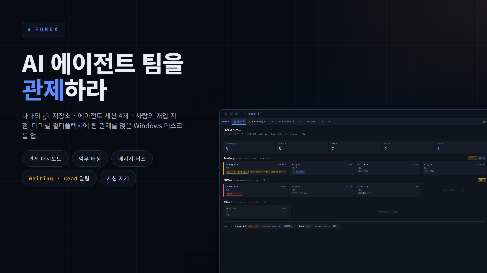

화면은 데모 데이터입니다.

<!-- ═══════════ 문제 제기 ═══════════ -->

## 터미널 4개를 알트탭으로 관제할 수는 없다

에이전트 CLI는 이미 훌륭하게 일합니다. 문제는 사람 쪽입니다 — 누가 승인을 기다리는지, 누가 죽었는지, 누가 무엇을 하고 있는지를 창 4개를 오가며 눈으로 쫓아야 합니다. EQMUX는 그 관제 업무를 화면 하나로 옮깁니다.

| 지금 | EQMUX |
|---|---|
| 승인 대기를 놓친다 | `waiting` 진입 즉시 OS 알림 — 창에 포커스가 있으면 억제하고, 반복은 합칩니다 |
| 죽은 세션을 늦게 발견한다 | `dead` 감지 + `재개` 버튼. 대화를 이어서 되살립니다 |
| 누가 뭘 하는지 모른다 | 상태 · 실행 중인 도구 · 서브에이전트 수 · 누적 비용 · 메모리를 실측해 보여줍니다 |

<!-- ═══════════ 3축 ═══════════ -->

## 보인다 · 맡긴다 · 믿는다

**보인다** — 팀 상태가 한눈에.
워크스페이스×세션 그리드가 주의가 필요한 순서로 정렬됩니다. 색은 `waiting`과 `dead`에만 씁니다.

**맡긴다** — 팀에게 일을 나눠준다.
직무 8종과 페르소나로 팀을 캐스팅하고, 임무를 배정하고, 에이전트끼리 업무를 주고받게 합니다.

**믿는다** — 앱은 선을 넘지 않는다.
API 키를 보유하지 않고, 아무것도 자동 실행하지 않고, git에 스스로 쓰지 않습니다.

<!-- ═══════════ 기능 ① 관제 ═══════════ -->

## 보고, 배정하고, 개입한다

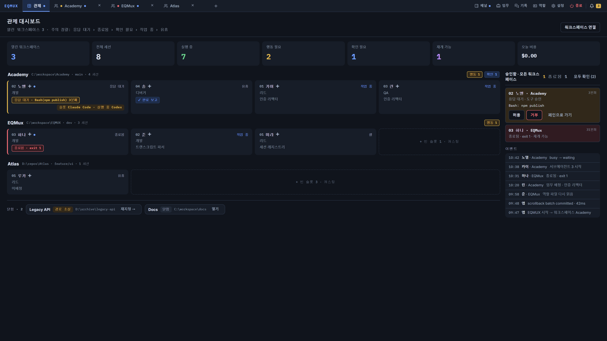

관제 탭은 앱을 켜면 가장 먼저 보이는 고정 탭입니다. 등록된 모든 워크스페이스가 행으로, 세션이 셀로 놓이고, 주의가 필요한 것이 위로 올라옵니다.

- **상태 6종 실시간** — `starting` · `busy` · `waiting` · `shell` · `idle` · `dead`. 폴링이 아니라 스트림 구독입니다.
- **에이전트 감지 배지** — 세션 프로세스 트리를 스캔해 실제로 돌고 있는 CLI(Claude · Codex · Gemini …)를 표시합니다. 터미널에서 직접 띄운 것도 잡힙니다.
- **알림은 꼭 필요한 것만** — `waiting`·`dead` 진입과 에이전트의 완료 보고에만. 창에 포커스가 있으면 억제하고, 세션당 60초로 합칩니다.
- **놓쳐도 찾아간다** — 알림은 앱 바 벨(알림 센터)에도 쌓입니다. 항목을 누르거나 `Ctrl+Shift+U`를 누르면 봐야 할 페인으로 바로 갑니다. `Ctrl+Shift+K`(macOS `⌘⇧K`) 건너뛰기 팔레트는 세션 · 워크스페이스 · 임무 · 화면 · 패널 탭으로 바로 갑니다.
- **개입은 사람이 한다** — 점프 · 재개 · 중지, 그리고 승인함. Claude Code의 도구 승인 요청이 대시보드에 모이고, 사람이 `허용` · `거부`를 누르면 Claude Code 권한 훅으로 전합니다. 앱이 대신 누르지 않습니다.
- **동시 편집 경고** — 두 세션이 같은 파일을 고치면 페인 머리 · 대시보드 · 알림 센터에 알립니다. 막지는 않습니다.

세션 셀을 열면 인스펙터에 실행 플래그 원문, 재개 근거, 슬롯 권한, 메모리와 비용까지 그대로 나옵니다.

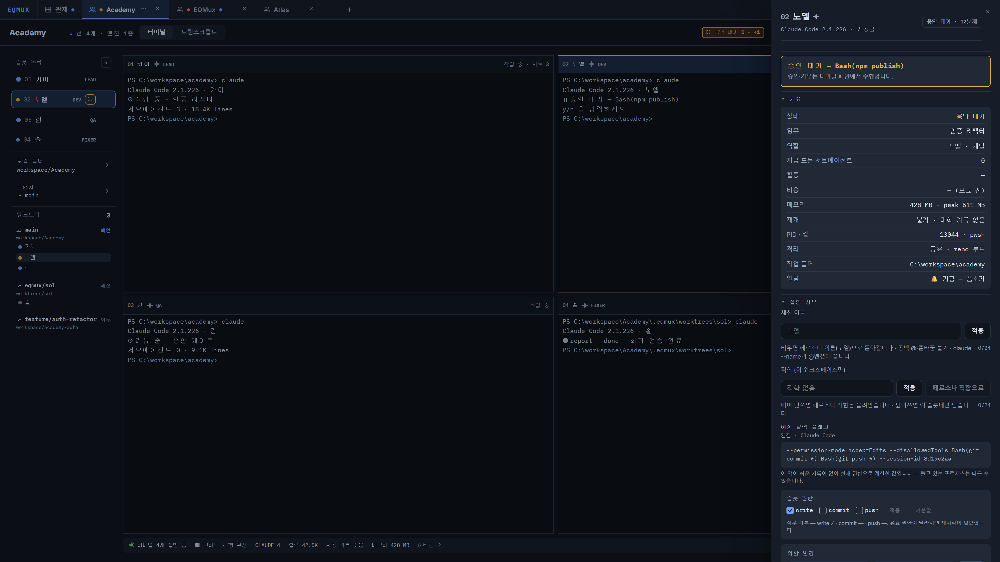

<!-- ═══════════ 기능 ② 터미널 ═══════════ -->

## 터미널이 작업 공간이다

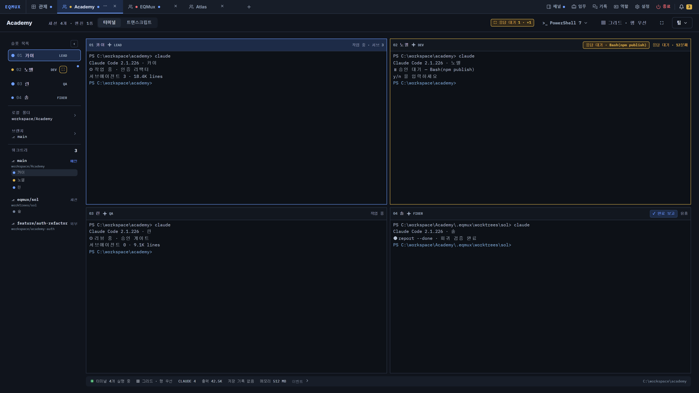

EQMUX는 에이전트를 감싸는 채팅 UI가 아닙니다. 페인마다 진짜 터미널(ConPTY)이 있고, 실제 일은 거기서 벌어집니다.

- **배치 6종** — 그리드(행/열) · 세로 스택 · 가로 나열 · 메인+우측 · 메인+하단. `Ctrl+Shift+L`로 전환하고, 분할선을 끌어 비율을 조정합니다.
- **셸 4종** — PowerShell 7 · Windows PowerShell · Git Bash · cmd
- **터미널 내 검색** — `Ctrl+F`. TUI로 키를 흘려보내지 않고 검색 바를 엽니다.
- **클립보드 · 드래그 앤 드롭** — 이미지를 붙여넣으면 PNG로 저장하고 경로를 넣어줍니다
- **실행 패널** — 서버 · 포트 · 환경변수 탭. 포트는 시작 때와 `다시 실측`을 누를 때 잽니다. 환경변수 탭에서 `.env` 계열 파일의 변수를 더하고 고치고 지우며, 값은 기본으로 가립니다.
- **확장 패널** — Claude Code 플러그인을 전체 또는 이 워크스페이스 범위로 켜고 끄고, MCP 설정을 보고 점검하고, 스킬을 만들고 복사합니다.

배치·비율·열린 탭·선택 세션은 저장되어 다음 실행에 그대로 복원됩니다. 워크스페이스 이름은 탭이나 관제 카드를 더블클릭해 바꿉니다.

<!-- ═══════════ 기능 ③ 팀 ═══════════ -->

## 직무와 페르소나로 팀을 만든다

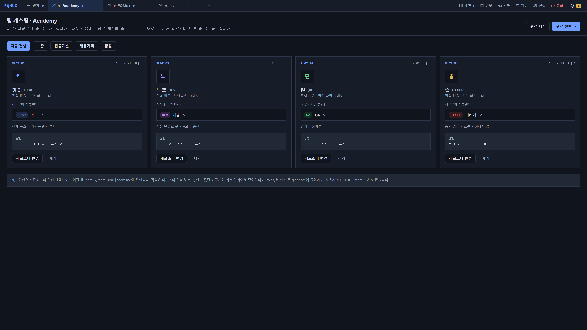

**직무**가 책임과 권한을 정하고, **페르소나**가 판단 성향을 정합니다. 둘은 분리되어 있습니다.

| | |
|---|---|
| **직무 8종 (고정)** | 리드 · 기획 · 개발 · 디자인 · QA · 디버거 · 문서 · 릴리즈 |
| **권한** | `write` / `commit` / `push` — push 권한은 리드와 릴리즈에만 |
| **페르소나 3단계** | 기본(판단 힌트) → 중간(+말투·성격) → 고급(캐릭터 시트) |
| **편성 프리셋** | 표준 · 집중개발 · 제품기획 · 품질 |
| **직함** | 직무 위에 붙이는 이름표. 역할 파일과 `team.md`에 들어가고 에이전트가 자기 직함으로 답합니다 |
| **빠른 시작** | 팀을 짜기 전이라도 폴더만 고르면 리드 + 개발 두 세션으로 시작합니다. 팀은 나중에 캐스팅에서 늘립니다 |

캐스팅 결과는 `.eqmux/team.json`과 사람이 읽는 `team.md`로 저장되고 repo와 함께 커밋됩니다. **팀 구성이 코드와 같이 이동합니다.**

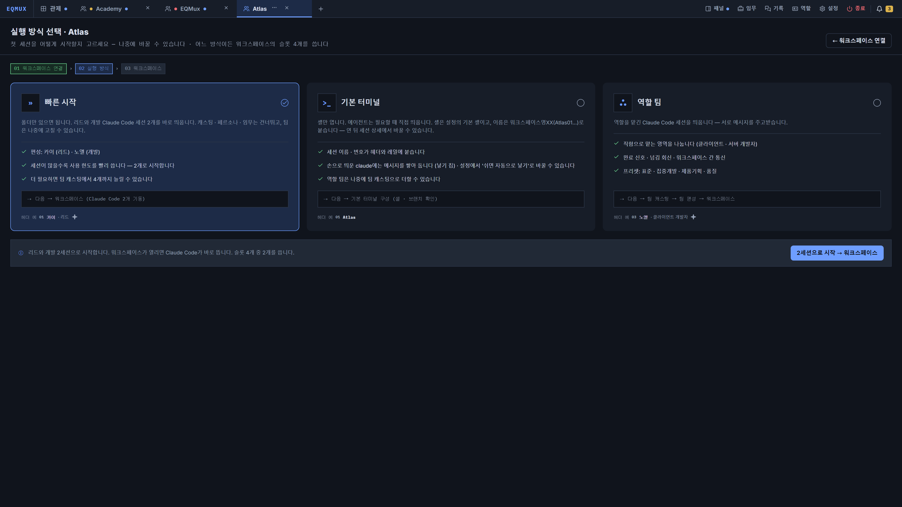

<!-- ═══════════ 기능 ④ 임무·대화 ═══════════ -->

## 임무를 주고, 에이전트끼리 말하게 하라

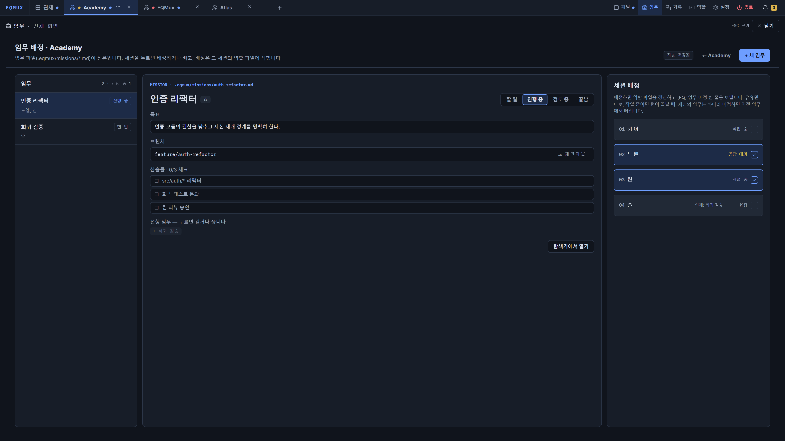

임무는 `.eqmux/missions/*.md` 파일이 원본입니다 — 브랜치와 목표, 산출물 체크리스트. 배정하면 역할 파일에 임무 블록이 들어가고, 살아 있는 세션에는 한 줄 브리프가 전달됩니다.

에이전트 간 메시지는 다섯 타입이 강제됩니다 — `ask` · `handoff` · `report` · `review` · `escalate`. 잡담이 아니라 업무 전달입니다.

- 작업 중인 세션에는 **턴이 끝난 뒤** 전달되어 흐름을 끊지 않습니다
- 사람도 `@페르소나이름`으로 같은 스트림에 참여합니다
- 에이전트는 터미널에서 `eqmux send` · `eqmux report`로 합류합니다
- 일을 끝낸 에이전트는 `eqmux report --done`으로 사람과 일을 맡긴 팀원에게 함께 알립니다
- 열린 다른 프로젝트의 에이전트에게도 `@이름`으로 보냅니다. 주소는 `eqmux who`로 봅니다

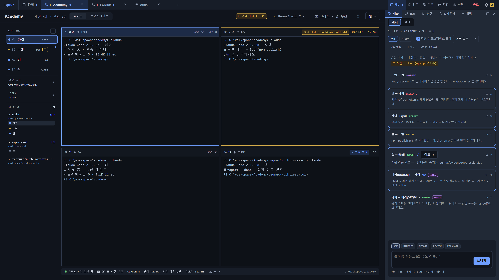

<!-- ═══════════ 기능 ⑤ 검토 ═══════════ -->

## 에이전트가 만든 변경을 사람이 검토한다

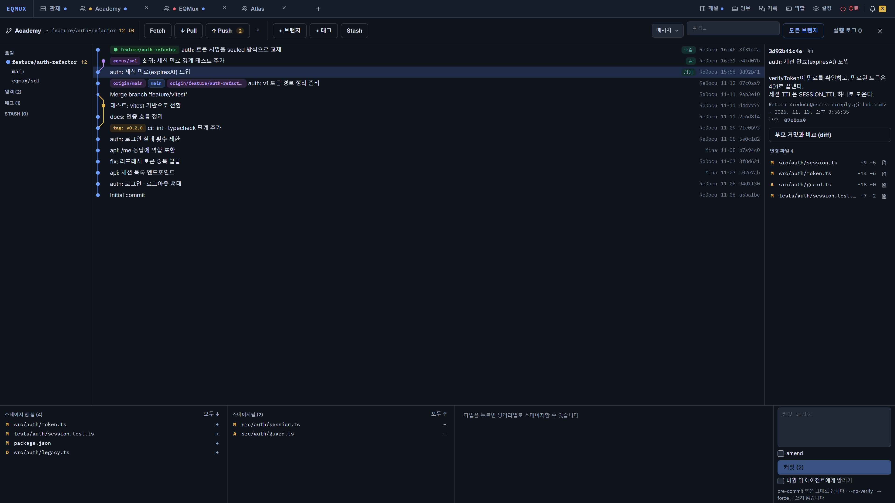

git 화면에서 브랜치 그래프 · 커밋 상세 · 파일 히스토리 · blame을 보고, diff 뷰어에서 나란히 비교합니다. 커밋 행을 클릭하면 부모 커밋과의 차이가 열립니다.

- **git 화면** — 파일 · 덩어리 단위 스테이징, 커밋 · amend, 브랜치 · 태그, fetch · pull · push, merge · rebase · cherry-pick · revert · stash, 충돌 덩어리 고르기. 커밋마다 고친 세션 배지가 붙습니다
- **임무 검토 화면** — 목표 · 완료 보고 · 담당 세션이 고친 파일 · 임무 시작점 기준 diff를 한 화면에서 보고, `테스트 실행` 뒤 `되돌려 보내기`나 `승인`을 누릅니다
- **워크트리 격리 (선택)** — 세션을 만들 때 고르면 `.eqmux/worktrees/<세션>`에 전용 작업 트리와 브랜치 `eqmux/<세션>`을 두어 에이전트끼리 작업이 섞이지 않습니다. 브랜치·워크트리 현황은 관제 레일에 보이고, 머지·정리는 사람이 합니다
- **파일 탐색기 + 에디터** — 100여 개 언어 문법 강조, 외부 변경 충돌 감지, 미저장 이탈 보호
- **트랜스크립트** — 에이전트 대화 로그를 턴 단위로 열람. 참조만 하고 복사하지 않습니다

**단, git 쓰기는 사람이 버튼을 눌러야 실행됩니다.** 앱이 스스로, 또는 에이전트 대신 커밋 · push하지 않습니다. `clean` · `--force` · `--no-verify` · 대화형 rebase는 막혀 있고, `reset --hard`는 두 번 묻습니다. 강제 push는 확인창을 거친 `--force-with-lease`만 씁니다. 에이전트가 작업 중이면 pull · 브랜치 전환 전에 경고합니다.

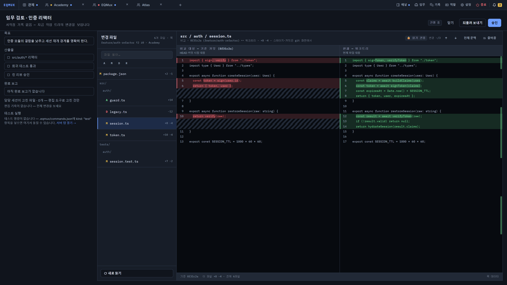

<!-- ═══════════ 기능 ⑥ 영속성 ═══════════ -->

## 꺼도 사라지지 않는다

스크롤백은 색까지 그대로 SQLite에 저장되고, 재시작하면 마지막 500줄(설정에서 250·1000)이 재생됩니다.

- **재개는 사람이 누른다** — 자동으로 되살리지 않습니다. 복원된 페인은 셸로 뜨고, 페인 메뉴나 세션 상세의 `재개`를 누르면 대화가 이어집니다
- **업데이트해도 남는다** — 워크스페이스 등록·배치·설정·라이브러리는 그대로입니다. 세션 DB(`session.db`)도 옮기지 않고 그 자리에서 새 형식으로 고칩니다. 등록·배치는 앱 데이터 밖에도 사본을 두어, 지워졌으면 시작할 때 되살립니다
- **창을 닫아도 돈다** — 창을 닫으면 트레이로 내려가고(macOS는 Dock에 남습니다) 세션은 계속 돕니다. 설정에서 닫을 때 종료하도록 바꿀 수 있습니다
- **웹뷰 크래시 생존** — 화면이 죽어도 터미널은 Rust가 쥐고 있어 그대로 이어집니다
- **고아 프로세스 0** — 세션마다 Job Object로 자식 트리를 묶습니다
- **검색** — 저장된 모든 스크롤백을 워크스페이스 전체에서 찾고, 과거 세션 검색으로 이 워크스페이스의 지난 Claude Code 대화를 찾아 재개합니다

<!-- ═══════════ 비교 ═══════════ -->

## 다른 도구와 무엇이 다른가

경쟁이 아니라 층이 다릅니다. **herdr는 런타임, EQMUX는 팀입니다.** Emdash는 태스크를 병렬로, EQMUX는 팀으로 돌립니다. 아래는 Windows · 팀 · 메시지 세 축에 한국어 입력만 더해 추린 것입니다(2026-10-14 조사 기준).

| 도구 | 층 | Windows | 팀 | 에이전트 간 메시지 | 한국어 IME |
|---|---|---|---|---|---|
| **EQMUX** | 팀 관제 데스크톱 앱 | ✓ 네이티브 | 직무 8종 + 페르소나 + 직함. 역할 파일이 실행 권한을 정합니다 | 타입 5종 강제 + SQLite 원장. 상태를 보고 전달하고, 다른 프로젝트에도 보냅니다 | 실기 확인 전 |
| herdr | 에이전트 런타임 (세션을 띄우고 살려 둔다) | ✓ | 없음 | `agent prompt --wait` — 상대 화면에 입력합니다. 타입·원장 없음 | △ 부분 지원 (후보 창 위치 문제, 자체 문서) |
| Emdash | 태스크 병렬 실행 데스크톱 앱 | ✓ 서명 MSI | 없음 | 없음 | – |
| Claude Code Agent Teams | Claude Code 내장 실험 기능 | △ 분할 페인이 Windows Terminal에서 안 됨 | 리드와 팀원. 역할별 권한은 없음 | `SendMessage` 메일박스. 평문 | – |
| oh-my-claudecode | Claude Code 플러그인 | △ 실험 (psmux) | 역할 19종 자동 배정. 권한은 우회로 고정 | 리더 ↔ 워커, 아웃박스 타입 9종 | × 알려진 문제 (자체 문서) |

값은 각 도구의 공개 문서를 2026-10-14에 조사한 것입니다. – 는 문서에 언급이 없다는 뜻입니다. EQMUX의 한국어 IME 칸은 실기로 확인한 뒤 채웁니다.

<!-- ═══════════ 신뢰 원칙 ═══════════ -->

## 하지 않는 것이 곧 설계다

에이전트에게 repo를 맡기는 도구는, 무엇을 할 수 있는지보다 **무엇을 하지 않는지**가 중요합니다.

| 하지 않는 것 | 이유 |
|---|---|
| **API 키를 보유하지 않는다** | 자체 AI 루프가 없습니다. 인증과 과금은 사용자의 CLI 몫입니다 |
| **아무것도 자동 실행하지 않는다** | 재시작 후에도 에이전트를 되살리지 않습니다. 재개는 사람이 누릅니다 |
| **git에 스스로 쓰지 않는다** | 스테이징 · 커밋 · push · merge는 git 화면에서 사람이 버튼을 눌러야 실행됩니다. `clean` · `--force` · `--no-verify` · 대화형 rebase는 막혀 있고, `reset --hard`는 두 번 묻습니다 |
| **승인을 대신 누르지 않는다** | 승인함의 `허용` · `거부`는 사람이 누릅니다. 답은 Claude Code 권한 훅으로 전하고, 에이전트 TUI에 키를 주입하지 않습니다 |
| **사용자 설정을 스스로 고치지 않는다** | `CLAUDE.md`는 수정하지 않습니다. `~/.claude`와 repo `.claude/`에는 확장 탭에서 사람이 누를 때만 씁니다 |
| **파일이 원본이다** | 팀 · 역할 · 임무는 `.eqmux/` 파일. DB는 캐시일 뿐이고, 불일치하면 파일이 이깁니다 |

<!-- ═══════════ 스펙 ═══════════ -->

## 스펙

| 항목 | 내용 |
|---|---|
| 플랫폼 | Windows 10/11 (WebView2) · macOS 11 이상 (Intel · Apple Silicon) macOS 판은 Intel 맥 · macOS 15에서만 실기로 확인했습니다 |
| 설치 | Windows — 포터블 zip: 압축을 풀고 `eqmux.exe` 실행, 설치·관리자 권한 불요 macOS — universal dmg: 응용 프로그램 폴더로 끌어 놓기 코드 서명 전이라 처음 열 때 경고가 뜹니다. Windows는 SmartScreen에서 `추가 정보` → `실행`, macOS는 Gatekeeper 절차를 한 번 거칩니다 |
| 에이전트 | Claude Code CLI · Codex CLI (별도 설치·로그인 필요) |
| 규모 | 워크스페이스 동시 10개 · 워크스페이스당 세션 4개 (설정으로 6·8) |
| UI 언어 | 한국어 · English |
| 기술 | Tauri 2 (Rust) · SolidJS · ConPTY + xterm.js · SQLite (WAL) |

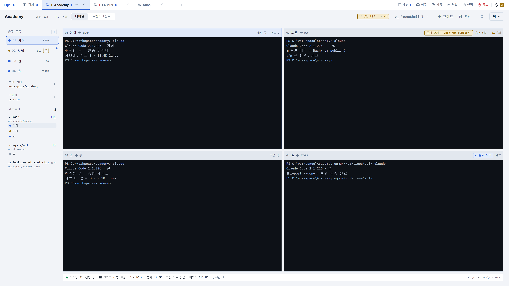

다크 · 라이트 · 시스템 테마를 지원합니다. 터미널 페인은 ANSI 색 가독성을 위해 어느 테마에서든 다크로 유지됩니다.

<!-- ═══════════ FAQ ═══════════ -->

## 자주 묻는 질문

**API 키를 넣어야 하나요?**
아니요. EQMUX는 API 키를 보유하지 않습니다. 이미 로그인된 Claude Code CLI를 실행할 뿐이고, 인증과 과금은 전부 CLI 쪽에서 일어납니다.

**Claude Code가 꼭 필요한가요?**
아니요. 에이전트 세션 기능(상태 감지 · 재개 · 역할 전달 · 메시지)은 Claude Code와 Codex를 지원하고, 한 팀에 둘을 섞을 수 있습니다. 모든 세션은 일반 셸로도 쓸 수 있고, 터미널에서 직접 띄운 Gemini 같은 다른 CLI도 관제 대시보드가 감지해 표시합니다.

**에이전트가 마음대로 커밋하거나 push하지 않나요?**
실행 권한은 직무별로 역할 파일에 명시됩니다. Claude Code는 실행 플래그로 강제하고, Codex는 샌드박스 플래그와 실행 지시로 제한합니다. push 권한은 기본적으로 리드·릴리즈 직무에만 있습니다. 앱의 git 화면에서 하는 커밋 · push는 사람이 버튼을 눌러야 실행되고, 앱이 스스로 하거나 에이전트 대신 하지 않습니다.

**앱을 끄면 작업 내용이 사라지나요?**
창을 닫으면 기본으로 트레이로 내려가고 세션은 계속 돕니다(설정에서 닫을 때 종료하도록 바꿀 수 있습니다). 앱을 종료해도 스크롤백 · 이벤트 · 대화는 SQLite에 저장되고 재시작하면 화면과 함께 복원됩니다. 에이전트 대화는 페인 메뉴나 세션 상세의 `재개` 한 번으로 이어집니다. 새 버전으로 업데이트해도 워크스페이스 등록과 배치는 남고, 세션 DB는 옮기지 않고 그 자리에서 새 형식으로 고칩니다.

**세션이 왜 4개인가요?**
리소스가 아니라 가독성 한계입니다 — 1920×1080에서 2×2 분할이 에이전트 TUI를 읽을 수 있는 한계입니다. 설정에서 6·8개로 늘릴 수 있습니다.

**macOS / Linux는요?**
macOS 판이 있습니다 — macOS 11 이상용 universal dmg(Intel · Apple Silicon)입니다. Apple 공증을 받지 않아(ad-hoc 서명) 처음 열 때 Gatekeeper 절차가 한 번 필요합니다. 실기 확인은 Intel 맥의 macOS 15에서만 했고, Apple Silicon 맥과 macOS 11–14는 확인하지 못했습니다. 이 페이지의 설명은 Windows 기준이며, macOS에서 다른 점과 알려진 한계는 릴리스 노트에 있습니다. Linux 판은 없습니다.

<!-- ═══════════ CTA ═══════════ -->

## 팀은 준비됐다. 관제탑만 세우면 된다.

[**Windows용 다운로드 (.zip)**](/download) · [**macOS용 다운로드 (.dmg)**](/download) · [**GitHub 저장소**](https://github.com/ReDocu/EQMUX)

무료 · 계정 불필요 · 오픈소스

### Windows 10/11 (x64)

- 파일은 `EQMUX_<버전>_x64_portable.zip`입니다. 포터블 zip이고, 1.0 전에는 설치 파일을 내지 않습니다
- 압축을 풀고 `EQMUX\eqmux.exe`를 실행합니다. 설치 과정이 없어 관리자 권한이 필요 없습니다
- 코드 서명 전이라 SmartScreen이 "Windows의 PC 보호"를 띄웁니다. `추가 정보` → `실행`을 누릅니다
- `eqmux.exe`는 앱이자 CLI입니다. 앱이 띄우는 터미널에서는 어디서든 `eqmux` 명령을 씁니다
- 0.4.x 이하의 옛 실행 파일은 지워 두세요. 한 번 띄우면 워크스페이스 등록과 배치를 지웁니다(0.5.1부터는 사본으로 되살립니다)
- 아는 한계 — 셸이 끝나는 순간 한꺼번에 많이 찍은 마지막 출력은 잘릴 수 있습니다. 이름도 부모 폴더 이름도 같은 탭은 툴팁의 경로로 구분합니다

### macOS 11 이상 (Intel · Apple Silicon)

- 파일은 `EQMUX_<버전>_universal.dmg`입니다. 한 파일로 Intel 맥과 Apple Silicon 맥에서 씁니다
- dmg를 열고 EQMUX를 응용 프로그램 폴더로 끌어 놓습니다. dmg에서 바로 실행하면 열리지 않거나 저장이 안 될 수 있습니다
- Apple 공증을 받지 않은 앱입니다(ad-hoc 서명). 처음 열 때 Gatekeeper가 막지만 고장이 아니고, 아래 절차는 처음 한 번만 하면 됩니다
- **macOS 15 이상** — 더블클릭 → "열지 않음" 창에서 `완료` → 시스템 설정 › 개인정보 보호 및 보안 › 보안의 `그래도 열기`. `휴지통으로 이동`은 누르지 마세요
- **macOS 11–14** — 응용 프로그램 폴더에서 Control-클릭(우클릭) › `열기`
- **터미널로 한 번에** — `xattr -dr com.apple.quarantine /Applications/EQMUX.app`
- "손상되었기 때문에 열 수 없습니다"가 뜨면 dmg를 다시 받아 체크섬을 확인하고, 그래도 같으면 위 `xattr` 명령을 실행합니다
- 시험 범위 — Intel 맥의 macOS 15에서 확인했습니다. Apple Silicon 맥과 macOS 11–14는 실기로 확인하지 못했습니다

### macOS 판의 알려진 한계

- 창을 닫으면(⌘W) 세션이 도는 동안 창만 숨기고 앱은 Dock에 남습니다. 끝내려면 메뉴 막대 아이콘의 `전부 종료`를 누릅니다
- 창을 Dock으로 오래 숨겨 둔 뒤 종료하면 확인 없이 세션이 정리될 수 있습니다(확인 중). 종료 전에 창을 한 번 열어 두면 안전합니다
- 다시 켜면 화면이 일부만 돌아옵니다. Claude Code 페인의 이전 화면은 재생되지 않고, 기본 터미널은 `▶ 셸 다시 열기`로 엽니다
- 입력칸이 따옴표와 대시를 바꿔 적습니다(macOS 텍스트 자동 고침). 시스템 설정 › 키보드 › 텍스트 입력에서 자동 대문자와 스마트 따옴표·대시를 끄면 피할 수 있습니다
- 터미널에서 ⌘A(전체 선택)가 동작하지 않습니다. 메뉴 막대는 기본 메뉴라 설정(⌘,)이 없고, 폴더 선택 창은 영어로 뜹니다
- 역할 세션을 띄울 때 이벤트 피드에 "사용자 요청으로 종료"가 한 번 찍힐 수 있습니다. 실제로 끈 것이 아닙니다

### GitHub · 공통

- 소스 · 변경 기록은 [GitHub 저장소](https://github.com/ReDocu/EQMUX)에, 버전별 파일과 릴리스 노트는 [릴리스](https://github.com/ReDocu/EQMUX/releases)에 있습니다. MIT 라이선스입니다
- 받은 파일은 릴리스에 붙은 `SHA256SUMS.txt`와 대조할 수 있습니다. Windows는 `Get-FileHash`, macOS는 `shasum -a 256`
- 베타입니다. 1.0 전이라 화면과 파일 형식이 바뀔 수 있습니다
- 에이전트 세션에는 Claude Code 또는 Codex CLI를 따로 설치해 한 번 로그인해 둡니다. EQMUX는 API 키를 갖지 않고 이 CLI를 띄울 뿐입니다. Node.js · Rust는 필요 없습니다
- 앱이 쓰는 곳은 앱 데이터 폴더, `~/.eqmux/logs`, 워크스페이스의 `.eqmux/`입니다. 로그에는 토큰이 평문으로 남을 수 있어 설정 › 저장소에서 끌 수 있습니다. 앱은 스스로 네트워크로 아무것도 보내지 않습니다
- 새 버전을 처음 켜도 워크스페이스 등록 · 배치 · 설정 · 세션 기록이 남습니다
- 버그 · 제안은 [GitHub Issues](https://github.com/ReDocu/EQMUX/issues)에, 그 밖의 문의는 문의 폼에 남겨 주세요

[시작 가이드](/docs#시작하기) · [기능 문서](/docs) · [자주 묻는 질문](/docs#faq)
